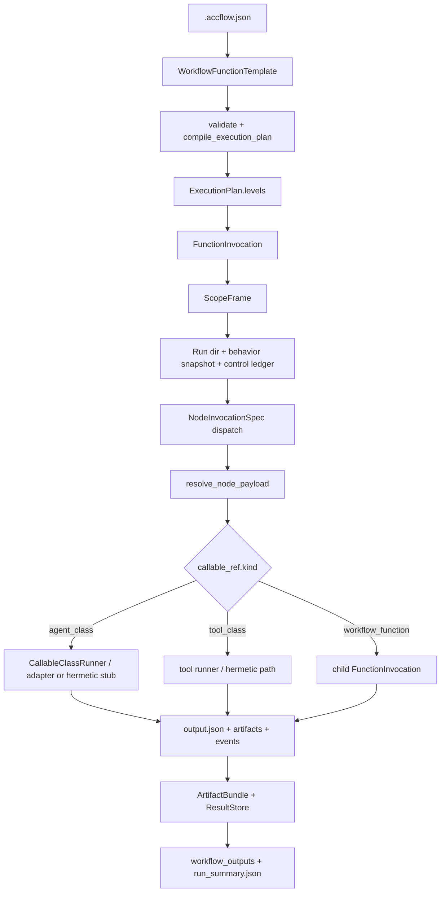
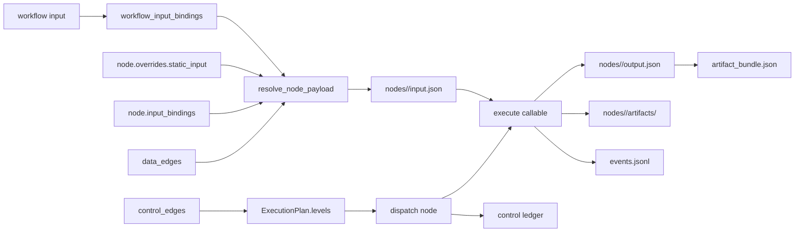

# ACC Workbench Product UI Architecture and Brandkit Direction

## 结论先行

ACC Workbench 不是一个“画几个 agent 方块然后随便连线”的 UI。按当前仓库实现，它应该是 Core v2 callable runtime 的可视化投影：左手编辑 reusable definitions 和 invocation call sites，右手查看 run-scoped evidence。产品化 UI 可以重做信息架构、视觉层级和交互手感，但不能把前端状态、运行结果、旧 graph 兼容字段或 LLM 建议当成 runtime truth。

最重要的 6 条结论：

1. Core v2 的合法执行链是 `WorkflowFunctionTemplate -> ExecutionPlan -> FunctionInvocation -> ScopeFrame -> NodeInvocationSpec -> SessionInstance / child FunctionInvocation -> output/artifact/event evidence`。
2. Workbench UI 应该投影真实对象：`AgentClassTemplate`、`ToolClassTemplate`、`WorkflowFunctionTemplate`、`NodeInvocationSpec`、`RunSummary`、`SessionInstance`、`ArtifactBundle`、`EventRecord`、control ledger，而不是自造一套 UI-only runtime。
3. authoring state 和 runtime evidence 必须分离：canvas/localStorage 只保存任务草稿、布局、选择、资源引用、invocation input；run 目录保存状态、输出、日志、事件、artifact 和失败证据。
4. `control_edges` 决定调度顺序；`data_edges` 决定端口数据物化，并且当前校验要求 data edge 必须沿着 control dependency。binding 是把 workflow input、static input、上游 output 放进节点 input payload 的规则。artifact 是运行产物证据。event 是运行过程证据。
5. 当前 web 边界是：`App` 管导航和资源索引，`WorkflowViewer` 管任务画布/运行 overlay/右侧 inspector，`CallableBrowser` 管资源库 agent class，`RunInspector` 管 run evidence，`ControlPlanePanel` 管 GraphOps/控制面入口。
6. 推荐视觉语言：ACC 应该走“深色、本地、圆角、低噪声的工程 Workbench”。核心隐喻仍然是“control ledger + evidence flow + callable scaffold”，但用户界面应把这些底层语义转译成“工作台、任务流、节点设置、本次运行、结果与日志、变更审核”。整体气质应接近本文后续参考图抽象：暗色柔和壳层、圆角面板、细网格画布、克制高亮、清晰运行证据，而不是尖锐战术终端、AI 聊天产品、营销落地页或花哨 SaaS dashboard。

本文只写架构分析和视觉方向，不改代码。

## 证据来源

主要依据这些当前仓库文件：

| 主题 | 文件 / 入口 |
| --- | --- |
| 架构总约束 | `README.md`、`docs/CURRENT_ARCHITECTURE.md`、`docs/concepts/FIRST_PRINCIPLES_ANALYSIS.md` |
| Core v2 domain model | `acc/domain.py` |
| Core v2 parse / validate / plan | `acc/engine/__init__.py`、`acc/engine/workflow_validation.py` |
| Core v2 runtime | `acc/app/core_v2_runtime.py` |
| Workbench draft -> Core v2 | `acc/app/workbench_adapter.py` |
| Async Workbench run manager | `acc/server/run_manager.py` |
| Server APIs | `acc/server/routes/workflows.py`、`acc/server/routes/runs.py` |
| Web API client / types | `web/src/api.ts`、`web/src/types.ts` |
| Web root shell | `web/src/App.tsx` |
| Canvas / task authoring | `web/src/components/WorkflowViewer.tsx` |
| Run overlay helpers | `web/src/components/workflow-viewer/runState.ts` |
| Evidence dock | `web/src/components/workflow-viewer/WorkflowEvidenceDock.tsx` |
| Resource library | `web/src/components/CallableBrowser.tsx` |
| Run inspector | `web/src/components/RunInspector.tsx` |
| Control plane panel | `web/src/components/ControlPlanePanel.tsx` |

关键行号索引：

| 事实 | 代码位置 |
| --- | --- |
| `ControlEdge` / `DataEdge` / `ArtifactBundle` / `PermissionProfile` | `acc/domain.py:100`、`acc/domain.py:114`、`acc/domain.py:165`、`acc/domain.py:176` |
| `NodeInvocationSpec` / `WorkflowFunctionTemplate` / `SessionInstance` | `acc/domain.py:329`、`acc/domain.py:349`、`acc/domain.py:410` |
| 编译 execution plan | `acc/engine/__init__.py:148` |
| control graph 拓扑层级 | `acc/engine/__init__.py:683` |
| data edge 必须跟随 control dependency | `acc/engine/__init__.py:710` |
| workflow path 启动 | `acc/app/core_v2_runtime.py:472` |
| workflow invocation 主循环 | `acc/app/core_v2_runtime.py:517` |
| 节点执行 + fixed ledger | `acc/app/core_v2_runtime.py:671` |
| 节点目录、payload、session、output、artifact bundle | `acc/app/core_v2_runtime.py:1195` |
| 节点 input payload 解析 | `acc/app/core_v2_runtime.py:1367` |
| callable 分派 | `acc/app/core_v2_runtime.py:1487` |
| child workflow callable | `acc/app/core_v2_runtime.py:1525` |
| workflow output 写出 | `acc/app/core_v2_runtime.py:1722` |
| event 追加 | `acc/app/core_v2_runtime.py:1857` |
| Workbench bundle 编译 | `acc/app/workbench_adapter.py:87` |
| Workbench draft 转 Core v2 | `acc/app/workbench_adapter.py:148` |
| data edge 自动补 control edge | `acc/app/workbench_adapter.py:433` |
| Workbench node 转 Core v2 node | `acc/app/workbench_adapter.py:521` |
| `WorkbenchRunManager` | `acc/server/run_manager.py:33` |
| Web shell `App` | `web/src/App.tsx:32` |
| Workbench canvas `WorkflowViewer` | `web/src/components/WorkflowViewer.tsx:391` |
| task localStorage key | `web/src/components/WorkflowViewer.tsx:376` |
| canvas edge model | `web/src/components/WorkflowViewer.tsx:157` |
| workspace canvas model | `web/src/components/WorkflowViewer.tsx:174` |
| task state model | `web/src/components/WorkflowViewer.tsx:270` |
| run projection model | `web/src/components/WorkflowViewer.tsx:300` |
| 保存 workflow 前 strip runtime state | `web/src/components/WorkflowViewer.tsx:992` |
| 提交 async run | `web/src/components/WorkflowViewer.tsx:1067` |
| run overlay helpers | `web/src/components/workflow-viewer/runState.ts:42`、`:71`、`:101`、`:116` |
| resource library | `web/src/components/CallableBrowser.tsx:88` |
| run inspector | `web/src/components/RunInspector.tsx:25` |
| evidence dock | `web/src/components/workflow-viewer/WorkflowEvidenceDock.tsx:29` |
| control plane panel | `web/src/components/ControlPlanePanel.tsx:15` |

## 一、用第一性原理理解 ACC Workbench

从第一性原理看，ACC 要解决的不是“让 AI 自动工作”这么泛的问题，而是：

> 我有一堆成熟外部 agent / local tool，如何把它们包装成可复用 callable，并用一个可审计、可重放、可解释的 workflow runtime 编排起来？

因此 ACC 必须分开 4 件事：

| 分离对象 | 大白话 | 代码对象 |
| --- | --- | --- |
| 定义 vs 执行 | “菜谱”和“这次做菜记录”不能混在一起 | `AgentClassTemplate` / `WorkflowFunctionTemplate` vs `FunctionInvocation` / `SessionInstance` |
| 控制流 vs 数据流 | “B 在 A 后面跑”不等于“B 可以读 A 的所有东西” | `control_edges` vs `data_edges` / `bindings` |
| 作者态 vs 运行证据 | “画布草稿”不是“运行事实” | task canvas / localStorage vs `runs/<run_id>/...` |
| LLM 建议 vs 人类授权 | agent 可以建议改 workflow，但不能偷偷改持久资产 | GraphOps validate / dry-run / human approval |

用费曼法说：

ACC 像一个工程外包调度台。`AgentClassTemplate` 是“某类工程师的岗位说明书”，`WorkflowFunctionTemplate` 是“这套任务流程图”，`NodeInvocationSpec` 是“这次流程里请某类工程师做某件事的工单”，`SessionInstance` 是“这个工程师这次真正干活留下的记录”。Workbench UI 的责任不是伪造工单完成状态，而是让你清楚看到：工单怎么写、什么时候派发、谁执行了、输入是什么、输出是什么、证据文件在哪里、失败时哪里坏了。

## 二、Core v2 的合法执行链是什么

### 2.1 合法链路

当前 Core v2 合法执行链：

```text
canonical .accflow.json
  -> parse WorkflowFunctionTemplate
  -> validate WorkflowFunctionTemplate
  -> compile ExecutionPlan
  -> create FunctionInvocation
  -> create ScopeFrame
  -> initialize run directory and control ledger
  -> for each topological level:
       dispatch NodeInvocationSpec
       resolve node input payload
       execute callable
       write SessionInstance / output / artifacts / events
  -> materialize workflow outputs
  -> write RunRecord / RunSummary
```

对应代码：

- `compile_execution_plan()` 先校验 template，再基于 `callable_topological_levels()` 生成 `ExecutionPlan.levels`：`acc/engine/__init__.py:148`、`acc/engine/__init__.py:683`。
- `run_core_v2_workflow_path()` 创建 `FunctionInvocation` 和 `ScopeFrame`：`acc/app/core_v2_runtime.py:472`。
- `run_workflow_function_invocation()` 创建 run 目录、写 snapshot、初始化 fixed control ledger，并按 `plan.levels` 调度节点：`acc/app/core_v2_runtime.py:517`。
- `execute_core_v2_node_with_fixed_ledger()` 在真正执行节点前后写 decision / dispatch / step transitions：`acc/app/core_v2_runtime.py:671`。
- `execute_core_v2_node()` 创建节点目录、写 `SessionInstance`、解析 payload、执行 callable、写 `output.json`、`artifacts/payload.json`、`artifact_bundle.json` 和 node/session evidence：`acc/app/core_v2_runtime.py:1195`。



### 2.2 调度只由 control edges 决定

`compile_execution_plan()` 的 `incoming` 依赖来自 `template.control_edges`，不是 `data_edges`。这意味着 UI 不能把 data edge 当成“隐式调度边”。

当前校验还要求：data edge 的 source 必须比 target 先运行，而且 source node 必须是 target node 的 control ancestor。代码在 `validate_callable_data_edges_follow_control_dependencies()`：`acc/engine/__init__.py:710`。

大白话：

```text
control edge: A -> B
含义：B 可以等 A 结束后再跑。

data edge: A.out -> B.in
含义：把 A 的某个输出端口物化成 B 的某个输入端口。

当前 ACC 要求：
如果存在 A.out -> B.in，那么也必须存在 A 到 B 的控制依赖路径。
```

Workbench adapter 也在帮 UI 兜底：`ensure_control_edges_for_data_edges()` 会为 data edge 自动补 control edge：`acc/app/workbench_adapter.py:433`。但产品化 UI 不应该把这个当成用户不可见的魔法。更好的 UI 是明确展示：“这条数据连接会同时建立执行顺序”。

### 2.3 节点执行的合法分叉

`execute_core_v2_callable()` 的分叉是当前合法 runtime 边界：`acc/app/core_v2_runtime.py:1487`。

| `callable_ref.kind` | 当前行为 | 代码依据 |
| --- | --- | --- |
| `workflow_function` | 解析 child workflow path，创建 `node_dir/nested_workflow`，递归调用 `run_core_v2_workflow_path()` | `acc/app/core_v2_runtime.py:1525` |
| `agent_class` | 如果 registry 能解析，就交给 `CallableClassRunner().run_agent_class(...)`，否则 fallback 到 hermetic callable | `acc/app/core_v2_runtime.py:1487` |
| `tool_class` | 当前主要通过 hermetic / generic tool 路径，不是 Workbench 自己执行 | `acc/app/core_v2_runtime.py:1487`、`execute_hermetic_callable()` |

这条边界很关键：Workbench 不应该自己实现 agent loop、tool loop、子 workflow loop。UI 只能提交 Core v2 workflow，runtime 负责执行。

### 2.4 节点 input payload 的组成顺序

`resolve_node_payload()` 是节点实际输入的来源：`acc/app/core_v2_runtime.py:1367`。

顺序是：

1. `node.overrides.static_input`
2. `template.workflow_input_bindings`
3. `node.input_bindings`
4. `template.data_edges`

每次物化都会写 `binding_manifest.json`，并向 workflow event log 写 `input_materialized`。这说明 binding 不是 UI 辅助字段，而是 runtime evidence 的一部分。

## 三、Workbench UI 应该投影哪些真实对象

Workbench 产品化时，画布上看起来可以是“任务”“workflow 容器”“agent 节点”“tool 节点”“端口”“连线”“证据面板”。但它们底层应该对应这些真实对象：

| UI 表面 | 应投影的真实对象 | 不应该变成 |
| --- | --- | --- |
| 资源库 Agent | `AgentClassTemplate` | 某个 canvas node 的私有 agent 配置 |
| 资源库 Tool | `ToolClassTemplate` | 前端直接执行的脚本按钮 |
| 已保存 Workflow | `WorkflowFunctionTemplate` | localStorage 里的画布快照 |
| 画布上的 agent/tool 节点 | `NodeInvocationSpec` call site | 新的 agent class 定义 |
| 画布上的 workflow 容器 | `workflow_function` callable 或 inline container 编译后的 child `.accflow.json` | UI-only nested graph |
| 控制连线 | `ControlEdge` | 携带数据的 edge |
| 数据连线 | `DataEdge` | 隐式调度边或共享内存引用 |
| 端口 | `PortContract` / `DataEndpoint` | 纯视觉 handle |
| 右侧 inspector 的 invocation tab | `prompt_policy`、`overrides.static_input`、`input_bindings` preview | class-level system prompt 编辑器 |
| 运行状态 overlay | `RunSummary` / events 推导出的 transient projection | 写回 workflow template 的 status |
| 证据 dock | `input.json`、`output.json`、`events.jsonl`、logs、artifacts | 前端缓存的伪证据 |
| 控制面 | GraphOps / control ledger projection | 直接文件编辑器 |

当前实现已经有这些投影入口：

- `App` 从 `/api/runs`、`/api/callables`、`/api/workflows` 加载全局资源：`web/src/App.tsx:32`。
- `WorkflowViewer` 拥有 canvas model、task store、run projections 和 inspector：`web/src/components/WorkflowViewer.tsx:391`。
- `CallableBrowser` 负责读取、创建、更新、删除 agent callable：`web/src/components/CallableBrowser.tsx:88`。
- `RunInspectorCore` 读取 run summary、node artifacts、artifact content 和 replay payload：`web/src/components/RunInspector.tsx:25`。
- `WorkflowEvidenceDock` 根据当前 task/run 上下文过滤证据内容：`web/src/components/workflow-viewer/WorkflowEvidenceDock.tsx:29`。
- `ControlPlanePanel` 目前是 GraphOps 和 run/artifact API 的浏览器入口：`web/src/components/ControlPlanePanel.tsx:15`。

## 四、哪些是 authoring state，哪些是 runtime evidence

### 4.1 Authoring state

Authoring state 是“用户正在编辑什么”。它可以存在于浏览器 state、localStorage 或保存前的 draft payload。它可以被撤销、重排、改名、另存为。

| Authoring state | 当前位置 / 代码 | 说明 |
| --- | --- | --- |
| task 列表、active task | `WorkbenchTask`、`WorkbenchTaskStorePayload`，`web/src/components/WorkflowViewer.tsx:270`、`:283` | 浏览器本地任务工作台状态 |
| canvas 结构和布局 | `WorkspaceCanvasModel`，`web/src/components/WorkflowViewer.tsx:174` | UI 用于画图的 projection model |
| 画布节点位置和尺寸 | `WorkflowContainerModel.position/size` | 可视化布局，不是 runtime truth |
| 选择对象、右侧面板开关 | `CanvasSelection`、`WorkbenchChromeState`，`web/src/components/WorkflowViewer.tsx:212`、`:294` | 交互状态 |
| invocation prompt / static input | `workflowInvocationPreview()`、`internalNodeInvocationPreview()` | call site 级别输入，不是 class prompt |
| resource-library agent draft | `AgentClassDraft` / `CallableBrowser` | 保存后成为 `AgentClassTemplate` YAML |
| workflow binding editor input | `WorkflowBindingView` 相关 UI | binding 配置，不是运行输出 |

当前代码已经明确在保存和运行前剥离 runtime state：

- `stripRuntimeStateFromCanvas()`：`web/src/components/workflow-viewer/runState.ts:101`
- `stripRuntimeStateFromWorkflow()`：`web/src/components/workflow-viewer/runState.ts:108`
- `saveGraph()` 调用 `graphForCurrentView(stripRuntimeStateFromCanvas(...))`：`web/src/components/WorkflowViewer.tsx:992`
- `runGraph()` 也基于 strip 后的 canvas 创建 runnable graph：`web/src/components/WorkflowViewer.tsx:1045`

### 4.2 Runtime evidence

Runtime evidence 是“已经发生的事实”。它必须来自 run 目录、server projection 或 result store，不能被 UI 自己编造。

| Runtime evidence | 当前写入 / 读取 |
| --- | --- |
| `run_record.json` | `run_workflow_function_invocation()` 写入 |
| `run_summary.json` | `write_core_v2_run_summary()` 写入；`/api/runs/{run_id}` 读取 |
| `function_invocation.json` | workflow run 启动时写入 |
| `scope_frame.json` | workflow run 启动时写入 |
| `behavior_snapshot/workflow_function_template.json` | workflow run 启动时 snapshot |
| `events.jsonl` | `append_event()` 追加，`acc/app/core_v2_runtime.py:1857` |
| `nodes/<node_id>/session_instance_manifest.json` | `execute_core_v2_node()` 写入 |
| `nodes/<node_id>/agent_payload.json` / `input.json` | `execute_core_v2_node()` 写入 |
| `nodes/<node_id>/runtime_payload.json` / `runtime.json` | `execute_core_v2_node()` 写入 |
| `nodes/<node_id>/binding_manifest.json` | `execute_core_v2_node()` 写入 |
| `nodes/<node_id>/output.json` | callable 执行后写入 |
| `nodes/<node_id>/artifacts/payload.json` | 节点输出的 artifact mirror |
| `nodes/<node_id>/artifact_bundle.json` | `ArtifactBundle` payload |
| `workflow_outputs/<port>/output.json` | `write_workflow_outputs()`，`acc/app/core_v2_runtime.py:1722` |
| control ledger | `run_plan.json`、plan step transitions、dispatch transitions、decision records |

### 4.3 UI overlay 是 projection，不是 evidence

`runState.ts` 提供的是 overlay helpers：

- `runOverlayFromRun()`：把 run summary 变成 canvas status overlay。
- `applyRunOverlayToCanvas()`：把 overlay 盖到 canvas model 上。
- `liveWorkflowRunFromEvents()`：在 run summary 还没有完整节点信息时，根据 events 做临时 live projection。

这些 helper 的语义是“投影”，不是“事实本身”。因此 UI 重构可以改善状态视觉表达，但不能把 overlay 结果写回 `.accflow.json`。

## 五、control edge / data edge / binding / artifact / event 的关系

### 5.1 一句话关系

```text
control edge 决定谁先后跑；
data edge 决定上游哪个端口的数据进入下游哪个端口；
binding 是把 workflow input、static input、上游 output 变成本节点 input payload 的规则；
artifact 是节点/工作流产出的可审计文件证据；
event 是运行过程发生过什么的时间线证据。
```

### 5.2 对比表

| 概念 | 属于 authoring 还是 runtime | 数据结构 | 作用 | UI 应该怎么表现 |
| --- | --- | --- | --- | --- |
| `control_edges` | authoring template | `ControlEdge(source, target, condition, context="none")` | 调度拓扑，只决定执行先后 | 独立的控制线，最好用不同颜色/线型；不能显示成数据传输 |
| `data_edges` | authoring template | `DataEdge(source: DataEndpoint, target: DataEndpoint, materialization)` | 端口到端口的数据物化 | 从 output port 到 input port 的数据线；显示 `copy/reference` |
| `workflow_input_bindings` | authoring template | `WorkflowInputBinding(source_port, target)` | 把 workflow exposed input 绑定到内部节点 input | 在 workflow 边界节点或 inspector 中展示 |
| `node.input_bindings` | authoring template | `NodeInputBinding(source/static_value, target_port)` | 显式把某个 source 或静态值绑定到节点输入 | 在节点 inspector 的 connections/input 中展示 |
| `overrides.static_input` | authoring call site | dict | call site 固定输入 | invocation input editor |
| `prompt_policy.user_prompt` | authoring call site | string | 这次调用的用户任务提示 | invocation tab；不要混成 class system prompt |
| `artifact_contract` | authoring contract | required/optional paths | 声明节点必须产出哪些文件 | 节点配置中的输出契约 |
| `ArtifactBundle` | runtime evidence | `bundle_id,node_id,run_id,outputs,files,provenance` | 一次节点运行的产物证据包 | output/artifacts tab |
| `events.jsonl` | runtime evidence | `EventRecord` lines | 运行时间线 | timeline / bottom dock / node event tab |
| control ledger | runtime evidence | `RunPlan`、`PlanStep`、`DispatchEnvelope`、`DecisionRecord` | 调度和决策审计 | control plane / run audit view |

### 5.3 关系图



### 5.4 UI 重构时的关键表达

产品化 UI 不应该让用户猜“这条线是什么”。推荐：

| 线型 | 表达 |
| --- | --- |
| control edge | 从节点主体到节点主体，细线，带执行箭头；标签是 condition / order |
| data edge | 从 output port 到 input port，强调端口和 materialization；标签是 `copy` / `reference` |
| workflow boundary binding | workflow 输入/输出边界节点，或 inspector 中的 boundary mapping section |
| artifact | 不画成普通 data edge；作为 run evidence / output bundle 展示 |
| event | 时间线，不是画布连线 |

## 六、当前 web UI 的主要组件边界

### 6.1 `App.tsx`

`App` 是 Workbench shell：

- 导航：tasks / resources / runs / artifacts / decisions / control。
- 拉取资源：`api.runs()`、`api.callables()`、`api.workflows()`。
- 保存 selected run/callable/workflow id。
- 把对应资源传给子面板。

它不应该承担 canvas 编辑细节，也不应该直接解释 run directory。

### 6.2 `WorkflowViewer.tsx`

`WorkflowViewer` 是当前最大的组件，承担这些职责：

| 职责 | 当前代码 |
| --- | --- |
| task localStorage | `TASK_STORE_KEY`、`loadTaskStore()`、`saveTaskStore()` |
| canvas model | `WorkspaceCanvasModel` |
| edge model | `WorkflowCanvasEdge` 区分 `kind: "data"` / `kind: "control"` |
| selection and chrome | `CanvasSelection`、`WorkbenchChromeState` |
| run projection | `RunProjection`、`runsById`、`runLogsById` |
| save/validate workflow | `saveGraph()`、`validateGraph()` |
| submit async run | `runWorkflowGraph()` |
| run overlay | 调用 `runOverlayFromRun()`、`applyRunOverlayToCanvas()` |
| inspector | `RightInspector`、`WorkflowInspector`、`InternalNodeInspector` 等 |
| evidence dock | `WorkflowEvidenceDock` |

产品化重构可以拆组件，但建议按语义拆，不要按视觉区域随便拆：

```text
TaskStore / CanvasAuthoring / RuntimeOverlay / Inspector / EvidenceDock / ResourcePicker / BindingEditor
```

### 6.3 `CallableBrowser.tsx`

`CallableBrowser` 是 resource-library 面板。它当前负责：

- 列出 callable summary。
- 读取 callable detail。
- 编辑 `AgentClassDraft`。
- 保存为 agent callable YAML。

这里有一个架构约束：系统提示词属于 `AgentClassTemplate.default_prompt`，不是任务节点私有字段。当前 editor 的 `default_prompt` 最终走 `api.createAgentCallable()` / `api.updateAgentCallable()`，由后端保存到 callable YAML。

UI 产品化时应该把资源库设计成“可复用能力资产库”，而不是把它混进某个 task canvas 的右侧节点表单。

### 6.4 `RunInspector.tsx` 和 `WorkflowEvidenceDock.tsx`

这两个组件都投影 runtime evidence，但职责不同：

| 组件 | 职责 |
| --- | --- |
| `RunInspectorCore` | run-centric 深入检查，读取 run summary、node artifacts、artifact content、replay payload |
| `WorkflowEvidenceDock` | 当前 task/run 上下文中的底部证据摘要和事件时间线 |

产品化 UI 可以把两者合并成统一 Evidence Experience，但底层仍应以 run_id / node_id / artifact path 为索引。

### 6.5 `ControlPlanePanel.tsx`

`ControlPlanePanel` 当前是 GraphOps / run / artifact API 的轻量入口。它不应该变成“直接改文件”的万能面板。GraphOps 文档要求：

```text
LLM proposes patch
  -> validate
  -> dry-run
  -> human review
  -> apply with explicit approval
```

这个边界来自 `docs/concepts/GRAPHOPS_CONTROL_PLANE.md`，也是产品化 UI 不能破坏的治理约束。

## 七、可视化 UI 重构不能破坏哪些架构边界

### 7.1 不能把 UI task state 当成 durable workflow truth

当前 `WorkflowViewer` 可以把 task 存在 localStorage，但保存/运行前必须转成 Core v2 payload。重构时不能让 localStorage 成为 workflow 的最终事实源。

必须保留：

- 保存 workflow 走 `/api/workflows`。
- 运行 workflow 走 `/api/workflows/run-graph/submit`。
- run evidence 走 `/api/runs/{run_id}`、`/api/runs/{run_id}/events`、artifact read API。

### 7.2 不能把 runtime status 写回 template

`status: running/success/failed` 是 run evidence 或 overlay，不是 `WorkflowFunctionTemplate` 的一部分。当前代码已经有 `stripRuntimeStateFromCanvas()`；重构时要保留这个概念。

### 7.3 不能合并 control edge 和 data edge

这是最容易破坏 Core v2 的地方。

错误做法：

```text
edge = { from, to, type, payload? }
```

然后让 UI 或 adapter 猜它到底是调度还是数据。

正确做法：

```text
control_edges: [{ from, to, condition, context: "none" }]
data_edges: [{ source: {node, port}, target: {node, port}, materialization }]
```

如果为了产品体验提供“一次拖线同时创建控制和数据关系”，也必须在数据模型中明确拆成两个事实。

### 7.4 不能把 class-level prompt 和 invocation prompt 混起来

当前设计：

- `AgentClassTemplate.default_prompt` 是 reusable class 的系统/方法提示，资源库编辑。
- `NodeInvocationSpec.prompt_policy.user_prompt` 是某次调用的 user task，画布节点编辑。
- `node.overrides.static_input` 是某次调用的结构化输入。

产品化 UI 应该把这三者明确分层：

| UI 区域 | 可编辑内容 |
| --- | --- |
| Resource Library / Agent Detail | default prompt、runtime、permissions、ports、artifact contract |
| Canvas Node Inspector / Invocation | user prompt、static input、input binding、workflow call binding |
| Run Evidence | resolved prompt、input.json、output.json、events、logs |

### 7.5 不能让前端直接解析 run directory 作为 primary data path

`web/README.md` 明确说 UI consumes `acc-server` endpoints，不应把 run directories 当主数据路径。前端可以显示 path，但读取应该通过 server API 和 path-safety。

### 7.6 不能绕开 GraphOps 的治理

任何“让 agent 帮我改 workflow / callable”的产品化功能，都必须走 proposal / validation / dry-run / human approval。不能做成“agent 返回 JSON 后前端直接 PUT 保存”。

### 7.7 不能恢复 legacy runtime 热路径

当前项目契约强调 `.accflow.json` 是 canonical on-disk template；旧 `.graph.json` 是 import-only。产品化 UI 不能为了兼容旧画布重新支持 legacy graph 作为 runnable workflow truth。

### 7.8 不能在 UI 实现自定义 LLM loop

ACC 的设计是“外部成熟 agent owns internal loop；ACC owns boundaries”。Workbench 可以创建 agent callable，可以提交运行，可以展示 transcript/logs，但不能自己实现 reasoning/tool-calling loop。

### 7.9 不能把 absolute workspace/run state 写进 reusable templates

`acc/engine/__init__.py` 有 `reject_absolute_workspace_paths()`，`workbench_adapter.safe_metadata()` 也过滤 `run_id`、`run_dir`、`workspace_root` 等字段。产品化 UI 的保存路径也要继续尊重这个边界。

## 八、产品化 UI 的信息架构建议

### 8.1 推荐第一屏

第一屏不做 marketing landing page。ACC 的第一屏应该是可操作的 Workbench：

```text
Left rail:
  工作台
  任务
  资源库
  运行记录
  结果与日志
  变更审核
  设置

Top bar:
  项目 / 当前模式 / 保存 / 校验 / 运行

Center:
  graph canvas

Right:
  selected node inspector

Bottom:
  本次运行 / 最近事件 / 结果文件 / 日志入口
```

这里的第一屏不是把 Core v2 对象直接摊给用户，而是把它们翻译成工作台语言：

| 底层事实 | 第一屏表达 |
| --- | --- |
| `WorkflowFunctionTemplate` / `NodeInvocationSpec` | 任务流画布和节点 |
| `control_edges` | 执行顺序 |
| `data_edges` / `bindings` | 数据传递和输入来源 |
| `RunSummary` / events | 本次运行和最近事件 |
| `ArtifactBundle` | 结果文件 |
| `stdout.log` / `stderr.log` | 查看日志 |
| GraphOps approval | 变更审核 |

### 8.2 三层 progressive disclosure

产品化重点不是堆信息，而是让用户逐层深入：

| 层级 | 默认显示 | 展开后 |
| --- | --- | --- |
| 操作层 | 节点名称、状态、使用模板、任务说明、输入来源、输出预览 | 节点配置、数据来源、产物入口 |
| 证据层 | 本次运行、最近事件、结果文件、日志入口 | output 内容、artifact list、事件时间线、stdout/stderr |
| 技术层 | 默认折叠，只给“更多技术详情”入口 | raw Core v2 invocation JSON、session manifest、binding manifest、schema、path |

原则是：用户先看到“能不能继续工作”，再看到“发生了什么”，最后才看到“底层文件和 contract 是什么”。不要默认把 `SessionInstance`、`ScopeFrame`、`manifest`、`output_schema.json` 这类词放在主界面上。

### 8.3 节点卡片建议

节点卡片应表达 5 件事实：

1. 这是 reusable class 的一次 invocation。
2. 它是什么 callable：agent/tool/workflow。
3. 它的输入端口和输出端口。
4. 它的运行状态只是 overlay。
5. 它有无可读 evidence。

不要把节点卡片做成聊天气泡，也不要把 agent avatar 放大成装饰重点。ACC 的核心是编排和证据，不是人格化聊天。

### 8.4 参考图抽象出的产品风格

用户给出的两张参考图应作为 ACC 后续 UI 的主方向。它们不是要照搬 Hiveward 或 issue 工具，而是抽象出一套适合 ACC 的产品规则：

| 维度 | 抽象规则 | ACC 中的落点 |
| --- | --- | --- |
| 整体气质 | 深色、柔和、安静、有工程可信度 | local-first Workbench，而不是 marketing page |
| 外壳布局 | 左侧固定导航 + 顶部操作栏 + 中央工作区 + 右侧设置/详情 + 底部运行证据 | `WorkbenchShell`、`TaskCanvas`、`RightInspector`、`EvidenceDock` |
| 主工作区 | 大圆角容器承载画布，容器边界清楚但不刺眼 | graph canvas 外层 shell radius 20-28px |
| 画布 | 近黑背景、细点阵网格、节点之间留足空间 | React Flow canvas，避免高饱和背景和大面积发光 |
| 节点 | 中等圆角、轻微 raised、状态 chip 稳定占位 | 节点卡片表达“任务节点”，不是底层 class dump |
| 连线 | 执行顺序和数据传递用不同线型/颜色，但都保持克制 | 执行顺序用浅灰实线，数据传递用 teal/cyan 虚线 |
| 右侧面板 | 像“节点设置”，默认显示用户能决策的信息 | 当前节点、使用模板、任务说明、输入来源、输出预览、更多技术详情 |
| 底部面板 | 像“本次运行”摘要，不像 raw log dump | 运行 ID、开始时间、最近事件、结果文件、日志入口 |
| 变更审核 | 分阶段横向进度 + 风险卡片 + 底部确认栏 | 变更建议 -> 自动校验 -> 预演结果 -> 人工确认 -> 应用变更 |
| 信息密度 | 中高密度，但每块有明确标题和边界 | 操作型工具，不做巨大 hero 和装饰插画 |
| 情绪表达 | 成功/等待/失败只用小面积状态色 | 绿色成功、琥珀等待/人工确认、红色失败/拒绝、teal 主操作 |

这套风格的第一性原理是：ACC 的用户不是来“欣赏 AI”，而是来控制一次可审计的本地运行。界面应让用户快速回答四个问题：

1. 现在在哪个工作区、哪个任务流？
2. 哪个节点正在运行或需要我确认？
3. 这个节点用了什么输入、产生了什么结果？
4. 如果我要改流程，哪些变更已经校验、哪些需要人工确认？

### 8.5 用户语言与底层语言的转译表

主 UI 默认使用中文用户语言；底层术语只在高级详情、日志、开发者模式或调试视图中出现。

| 底层术语 | 主 UI 文案 | 出现位置 |
| --- | --- | --- |
| `AgentClassTemplate` | 智能体模板 | 资源库、节点设置 |
| `ToolClassTemplate` | 工具模板 | 资源库、节点设置 |
| `WorkflowFunctionTemplate` | 工作流模板 / 任务流 | 资源库、工作台 |
| `NodeInvocationSpec` | 任务节点 / 节点设置 | 画布、右侧面板 |
| `FunctionInvocation` | 本次运行 / 运行记录 | 底部运行条、运行记录页 |
| `ScopeFrame` | 运行环境 | 技术详情 |
| `SessionInstance` | 节点执行记录 | 技术详情、失败排查 |
| `control_edges` | 执行顺序 | 画布图例、连线提示 |
| `data_edges` / `bindings` | 数据传递 / 输入来源 | 画布图例、节点设置 |
| `ArtifactBundle` | 结果文件 / 产物 | 底部运行条、结果与日志 |
| `events.jsonl` | 事件时间线 | 运行详情、失败排查 |
| `stdout.log` / `stderr.log` | 运行日志 | 日志入口 |
| GraphOps | 变更审核 | 左侧导航、审核页 |
| proposal / validation / dry-run / approval / apply | 变更建议 / 自动校验 / 预演结果 / 人工确认 / 应用变更 | 变更审核页 |

这张表是实现 UI 文案时的约束：除非用户进入“更多技术详情”，否则不要在主界面直接暴露 `NodeInvocationSpec`、`ScopeFrame`、`SessionInstance`、`manifest`、`output_schema.json` 等内部名词。

## 九、基于 brandkit 的 ACC 视觉语言推荐

### 9.1 Brand strategy

| 项 | 推荐 |
| --- | --- |
| Category | Developer tool / local-first orchestration workbench |
| Audience | 工程师、架构师、agent workflow builder、需要审计运行证据的人 |
| Product function | 把成熟 agent/tool 包装成 reusable callable，并用 Core v2 workflow 编排和审计 |
| Emotional promise | 可控、清晰、可追踪，不靠玄学自动化 |
| Trust posture | 工程控制台，不是玩具 demo；默认审计、默认边界、默认本地优先 |
| Core metaphor | control ledger + evidence flow + callable scaffold |
| Should avoid | 泛 AI 紫蓝渐变、聊天机器人风格、营销 hero、过度拟人化 agent、满屏玻璃卡片 |

### 9.2 Recommended visual mode

按 brandkit 规则，ACC 最适合的方向已经从早期的“硬朗工业控制台”收敛为：

```text
Dark Rounded Local Workbench
  +
Evidence-first Operator Console
```

也就是说：保留工程感、可审计感和本地优先感，但把尖锐边框、军事终端感、过强网格和大面积红框降下来。ACC 的气质应该更像：

```text
near-black rounded workspace
soft graphite panels
warm off-white Chinese UI text
teal for primary run/callable identity
cyan for data transfer only where needed
amber for waiting/human gate
coral/red for failure/destructive actions only
low-contrast borders and separators
```

### 9.3 Palette

推荐 palette：

| Token | 用途 | 建议颜色 |
| --- | --- | --- |
| `--acc-app-bg` | app 最底层背景 | `#0D0F12` |
| `--acc-shell-bg` | 左侧导航和顶部壳层 | `#12151A` |
| `--acc-panel-bg` | 主工作区面板 | `#15191F` |
| `--acc-panel-raised` | 右侧 inspector / 底部 dock / 卡片 | `#1A1F26` |
| `--acc-card-bg` | 节点卡片和建议卡片 | `#20252D` |
| `--acc-border-soft` | 普通边框 | `rgba(255, 255, 255, 0.08)` |
| `--acc-border-strong` | 选中/聚焦边框 | `rgba(255, 255, 255, 0.16)` |
| `--acc-text` | 主文本 | `#F4F1E8` |
| `--acc-muted` | 次级文本 | `#A6ADB7` |
| `--acc-subtle` | 弱提示 / placeholder | `#6F7782` |
| `--acc-primary` | 主操作、运行、选中节点 | `#16B89E` |
| `--acc-data` | 数据传递 | `#4DBFD8` |
| `--acc-control` | 执行顺序 | `#D7D3C7` |
| `--acc-waiting` | 等待、人工确认 | `#D6A126` |
| `--acc-success` | 成功 | `#57C56F` |
| `--acc-danger` | 失败、拒绝、破坏性动作 | `#E75D55` |
| `--acc-artifact` | 产物/结果文件 | `#A78BFA` |

注意：`--acc-artifact` 可以带一点紫，但不能让整体 UI 变成紫蓝 AI glow。

### 9.3.1 Shape and elevation tokens

参考图最重要的不是颜色，而是“柔和但有边界”的形状系统。建议固定这些 token：

| Token | 用途 | 建议值 |
| --- | --- | --- |
| `--acc-radius-window` | app 主窗口 / 最大内容容器 | `24px` |
| `--acc-radius-shell` | 画布外壳、审核页主面板 | `20px` |
| `--acc-radius-panel` | inspector、dock、列表容器 | `16px` |
| `--acc-radius-card` | 节点、建议卡片、结果文件卡片 | `12px` |
| `--acc-radius-control` | button、select、search、status chip | `10px` |
| `--acc-shadow-shell` | 主工作区阴影 | `0 18px 60px rgba(0, 0, 0, 0.35)` |
| `--acc-shadow-card` | raised 卡片阴影 | `0 10px 32px rgba(0, 0, 0, 0.24)` |

边框规则：

- 主容器使用 20-28px 大圆角，形成“本地应用窗口”的感觉。
- 节点和卡片使用 10-14px 中圆角，避免早期工业风的尖锐直角。
- button / chip / input 用 8-10px 圆角，不做过度胶囊化，除非是状态 chip。
- 选中状态优先用细边框、轻微 glow 和局部状态色，不用整块高饱和背景。
- 红色只能用于失败、拒绝、危险权限，不用于普通框选或布局强调。

### 9.4 Typography

推荐：

| 层级 | 字体方向 |
| --- | --- |
| UI text | system sans，中文优先可读，不做花哨字重 |
| IDs / paths / JSON / logs | monospace |
| Section title | 小号、紧凑、清晰，不要 hero-scale |
| Status / port labels | 稳定宽度，避免运行状态切换导致布局跳动 |

ACC 是操作型工具，不需要巨大 marketing H1。标题应该服务扫描，而不是制造情绪。

### 9.5 Logo / mark direction

推荐 logo 概念：

```text
ACC monogram + directed graph scaffold + ledger column
```

可解释为：

- `A`：agent / artifact 的入口。
- `C`：callable boundary。
- `C`：conductor / control ledger。
- 中间用负空间形成一条从左到右的 data/control path。

不要用：

- 随机 sparkles。
- 通用 bot 头像。
- 闪电图标。
- 复杂大脑/神经网络图案。
- 过度像 OpenAI/Codex/Claude 的品牌符号。

### 9.6 Component visual language

| 组件 | 视觉建议 |
| --- | --- |
| Left rail | 低噪、固定宽度、icon + 中文 label；当前 view 用柔和 raised 背景 + teal 小提示，不用大面积亮色 |
| Top bar | 项目、当前模式、保存、校验、运行；按钮圆角 10px，主运行按钮 teal，普通按钮低对比 |
| Canvas shell | 大圆角深色面板，内部细点阵网格；画布边界清楚但不刺眼 |
| Canvas toolbar | 悬浮在画布左上，使用 icon button，hover 有轻微 raised |
| Workflow node | 12px 左右圆角，固定尺寸区间，标题/说明/status chip 分层，选中态用 teal 边框 |
| Start / human gate node | 允许有轻微语义色背景，但饱和度低；人工确认用 amber |
| Control edge | 低饱和浅灰实线，表达“执行顺序” |
| Data edge | teal/cyan 虚线或细线，表达“数据传递”，不要和控制线混淆 |
| Inspector | 右侧固定圆角面板，标题是“节点设置”；默认显示当前节点、使用模板、任务说明、输入来源、输出预览 |
| Evidence dock | 底部“本次运行”，展示运行状态、最近事件、结果文件、日志入口；不默认展开 raw logs |
| Run status | stable chips，不改变节点尺寸；成功绿、运行中蓝/teal、等待 amber、失败 red |
| Change review | 横向阶段条 + 左侧建议列表 + 中间详情 + 右侧校验/预演 + 底部人工确认栏 |
| Technical details | 默认折叠为“更多技术详情”，只在需要 debug 时展开 |

### 9.7 Brandkit board prompt

如果后续要用 brandkit 生成 ACC 的品牌板，可以用这个方向：

```text
Create a premium brand-kit overview image for "Agent Callable Conductor".

Brand strategy:
- category: local-first developer orchestration workbench
- audience: engineers, agent workflow builders, architecture reviewers
- personality: precise, auditable, controlled, builder-native, calm
- core metaphor: control ledger plus evidence flow plus callable scaffold
- logo idea: an ACC monogram built from directed graph lines, bounded frames, and a ledger column; negative space suggests a data/control path moving through callable boundaries

Layout:
3x3 grid on a dark rounded product-guidelines canvas with soft graphite panels, clear gutters, clean alignment, and refined negative space.

Panels:
- logo cover with ACC wordmark
- logo construction showing graph/ledger geometry
- product surface showing a Chinese local-first workflow canvas with a left rail, top action bar, right "节点设置" inspector, and bottom "本次运行" evidence dock
- tagline: "Orchestrate agents. Keep the evidence."
- color system with charcoal, off-white, teal, cyan, amber, coral
- typography specimen with monospace path/log examples
- physical application as an engineering notebook or security-style audit badge
- image direction: calm dark engineering workstation, subtle dotted grid overlay, rounded panels, no people
- system detail: execution order, data transfer, status chips, result file badge, change review gate

Visual mode:
Dark Rounded Local Workbench plus Evidence-first Operator Console.

Palette:
near-black charcoal, soft graphite surfaces, warm off-white Chinese UI text, teal primary action, cyan data transfer, amber human confirmation, coral failure, restrained low-contrast borders.

Style:
premium, calm, rounded, intentional, polished, product-guidelines deck, no clutter, no generic AI purple-blue glow, no chat-bot mascot, no marketing hero, no sharp military terminal aesthetic.
```

### 9.8 推荐 tagline

候选：

| Tagline | 适用 |
| --- | --- |
| `Orchestrate agents. Keep the evidence.` | 最准确，强调编排和证据 |
| `Callable workflows, auditable runs.` | 更工程、更直接 |
| `Every agent run, bounded and traceable.` | 强调边界和可追踪 |
| `Build flows. Prove what happened.` | 更产品化 |

首推：

```text
Orchestrate agents. Keep the evidence.
```

原因：它同时覆盖 ACC 的两个核心价值：agent orchestration 和 runtime evidence。

## 十、UI 重构建议的最小路径

这不是实现计划，只是为了避免视觉重构走错模型。

### 10.1 先定义产品化信息架构，不先改 CSS

建议先把 UI 拆成这些语义区：

```text
WorkbenchShell
  ResourceLibrary
  TaskCanvas
  CanvasToolbar
  RightInspector
  EvidenceDock
  RunMonitor
  DecisionInbox
  ControlLedgerView
```

`WorkflowViewer.tsx` 当前功能太集中，产品化时最适合按“authoring / runtime projection / evidence / resource selection”拆，而不是按页面视觉块硬拆。

视觉落地时也要先定 shell，而不是先微调单个 button：

```text
App frame
  -> left local workspace rail
  -> top project/action bar
  -> rounded canvas shell
  -> selected node inspector
  -> current run evidence dock
  -> change review surface
```

这条顺序能保证 ACC 的整体气质接近参考图：先有稳定的本地工作台骨架，再让节点、连线、日志、审核控件进入这个骨架。不要从零散卡片样式开始改，否则很容易变回“很多暗色 card 拼在一起”的普通 SaaS dashboard。

### 10.2 保留转换边界

无论 UI 内部 model 如何变，保存/运行前都必须经过：

```text
UI canvas model
  -> Workbench graph payload
  -> workbench_adapter canonicalize/compile
  -> Core v2 WorkflowFunctionTemplate
```

不要让 UI 直接写 canonical Core v2 的所有字段，除非同时保留 adapter 校验。

### 10.3 先产品化 edge/port 语义

最值得优先做的视觉能力：

1. 明确 control mode / data mode。
2. 端口可见且稳定。
3. data edge 创建时提示会补 control dependency。
4. edge inspector 清楚展示 source/target/materialization。
5. 运行 overlay 不改变 authoring edge。

### 10.4 Evidence-first，而不是 animation-first

ACC 的高级感来自“我能解释每一步发生了什么”，不是来自复杂动效。动效应该只用于：

- active run pulse；
- newly materialized input；
- node completed/failure transition；
- evidence dock new event indicator。

不要让动画遮蔽日志、输出、端口和错误。

## 十一、待验证和风险

本次只做静态代码与文档分析，没有运行测试，也没有改 UI 代码。

需要后续验证：

1. 浏览器中确认中文文本是否真实乱码。PowerShell 输出里部分中文呈 mojibake，但这可能是终端编码显示问题，也可能是源文件编码问题。
2. 用当前 `http://127.0.0.1:5173/` 跑一次 “保存 -> 校验 -> submit run -> 查看 evidence dock” 浏览器 journey，确认 UI projection 与 run evidence 对齐。
3. 如果重构 `WorkflowViewer.tsx`，先加/保留覆盖 `stripRuntimeStateFromCanvas()`、data/control edge、run overlay 的 focused tests。
4. 如果新增视觉 token，不要引入一套和架构无关的大型 design system；优先 CSS variables + 现有 lucide icons + React Flow。
