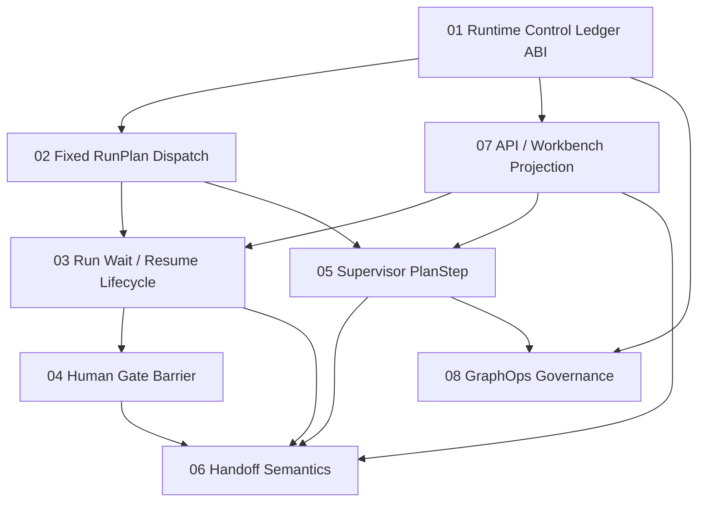

# ACC Control Architecture Design Package

生成日期: 2026-06-02

本文档包把 `docs/CONTROL_ARCHITECTURE_GAP_REVIEW.md` 里的结论拆成可以逐个用 goal
模式落地和验证的 design。核心判断是: 不为 fixed workflow、supervisor、handoff 各做一套
runtime, 而是在当前 Core v2 callable runtime 前后补一条统一的运行期控制链:

```text
ControlPolicy
  -> RunPlan
  -> PlanStep
  -> DispatchEnvelope
  -> DecisionRecord
  -> SessionInstance / FunctionInvocation / ArtifactBundle
  -> ReplayPolicy
```

## 设计原则

1. 固定 DAG、supervisor、handoff 的区别不在于执行器不同, 而在于谁有权产生或更新
   `PlanStep`。
2. `execute_core_v2_node()` / Core v2 callable substrate 仍是唯一生产执行路径。
3. `DecisionRecord` 是运行期决策真相, `/api/decisions` 和 Workbench 都只是 projection。
4. `events.jsonl` 是时间线索引, 不应继续扩散 `workflow_events.jsonl` 这类旧 schema。
5. GraphOps 只处理持久 workflow/template/resource mutation, 不处理 runtime dispatch。
6. Workbench 不保存运行事实, 只保存 authoring state 和 `run_id` 指针。

## 执行顺序



## 文档清单

| 顺序 | 文档 | 目的 | 必须先完成 |
| --- | --- | --- | --- |
| 1 | `01_RUNTIME_CONTROL_LEDGER.md` | 定义 `ControlPolicy`、`RunPlan`、`PlanStep`、`DispatchEnvelope`、`DecisionRecord`、`ReplayPolicy`、canonical event/decision ABI、store reader/writer 和 projection loader。只做 ABI, 不接 runtime hot path。 | 无 |
| 2 | `02_FIXED_RUNPLAN_DISPATCH.md` | 把现有 fixed DAG 热路径投影到 `RunPlan` / `PlanStep` / `DispatchEnvelope`, 保持行为等价。 | 01 |
| 3 | `03_RUN_WAIT_RESUME_LIFECYCLE.md` | 定义 fresh/wait/resume 生命周期, 防止 human gate 用 destructive fresh run 恢复。 | 01, 02 |
| 4 | `04_HUMAN_GATE_BARRIER.md` | 把 `InteractionRequest` 从 UI card 升级为 scheduler barrier, answer 后写 `DecisionRecord` 并 enqueue `WakeupRequest`。 | 01, 02, 03 |
| 5 | `05_SUPERVISOR_PLANSTEP.md` | 让 supervisor 只产出 validated plan/intent/decision 和 `PlanStep`, 不直接执行 callable。 | 01, 02 |
| 6 | `06_HANDOFF_SEMANTICS.md` | 定义 typed handoff 的 source/target/mode/payload/acceptance/timeout/fallback/replay 语义。P0 先收窄到 validation/new_session/route_only。 | 01, 03, 04, 05 |
| 7 | `07_API_WORKBENCH_PROJECTION.md` | 定义 API 和 Workbench 如何读取控制账本, 保证 UI projection 不成为 runtime truth。先 fixed-only, 再按 human/supervisor/handoff 增量扩展。 | 01, 可与 02 后半并行 |
| 8 | `08_GRAPHOPS_GOVERNANCE.md` | 固化 GraphOps 只做 proposal/validate/dry-run/human-approved apply, 不进入 runtime dispatch。 | 01, 05 |

## P0 验收总线

后续每个 goal 落地时, 不论做哪个 design, 都必须守住这些总线:

- 默认测试保持 hermetic, 不依赖真实 Codex/Claude/Cursor/Gemini、网络、浏览器凭证或付费服务。
- `acc.domain` / `acc.engine` 保持 pure, 不做 filesystem IO、subprocess、server/UI import 或 host env 读取。
- 新运行事实写入 run dir, 不写回 `.accflow.json` template 或 Workbench localStorage。
- 新增持久文件必须说明 owner、schema、writer、reader、是否 source of truth。
- fixed workflow 输出、artifact、result store、run summary 在 P0/P1 期间必须行为等价。
- 不能把 `CallableInvocationService` 扩成生产执行器。
- 不能把 `WorkbenchRunManager` 扩成 durable scheduler truth。
- 不能把 GraphOps apply 作为 runtime supervisor/handoff 的一环。

## 推荐 goal 切分

1. Goal 1: 落地 `01_RUNTIME_CONTROL_LEDGER.md` 的 schema、validators、store writers/readers、
   projection loaders 和新增 control event ABI。不改 runtime hot path, 验收为无行为变化。
2. Goal 2: 落地 `02_FIXED_RUNPLAN_DISPATCH.md`, fixed `ExecutionPlan -> RunPlan/PlanStep`
   conversion 和 fixed dispatch ledger, 保持 fixed output 等价。
3. Goal 3: 落地 `07_API_WORKBENCH_PROJECTION.md` 的 fixed-only read API projection, 可选最小
   Workbench 展示; 不碰 human/supervisor/handoff。
4. Goal 4: 落地 `03_RUN_WAIT_RESUME_LIFECYCLE.md`, 定义 waiting/resume status、non-destructive
   resume、`WorkbenchRunManager` 非终态处理和 wakeup consumer 边界。
5. Goal 5: 落地 `04_HUMAN_GATE_BARRIER.md`, 先用 hermetic fake workflow 验证 approval barrier。
6. Goal 6: 落地 `05_SUPERVISOR_PLANSTEP.md` P0: approved `SupervisorPlan` -> validated
   `PlanStep[]` + `DecisionRecord`, 不执行 worker。
7. Goal 7: 落地 `05_SUPERVISOR_PLANSTEP.md` P1: supervisor dispatch integration + fake E2E。
8. Goal 8: 落地 supervisor replay, 复用 recorded `DecisionRecord`, 不重新问 LLM。
9. Goal 9: 落地 `06_HANDOFF_SEMANTICS.md` P0: typed policy validation、illegal target reject、
   `new_session` / `route_only`; `resume_session`、timeout、fallback、replay 后移。
10. Goal 10: 落地 `08_GRAPHOPS_GOVERNANCE.md` Option A: 明确 proposal/dry-run only。Option B
    human-approved apply 必须单独 goal/ADR。

## 当前代码事实基线

- fixed workflow 热路径: `WorkflowAppService.run()` -> `run_core_v2_workflow_path()` ->
  `compile_execution_plan()` -> `run_workflow_function_invocation()` -> `plan.levels` ->
  `execute_core_v2_node()`。
- supervisor scaffold 已有: `DynamicInvocationIntent`、`SupervisorPlan`、`SupervisorDecision`、
  `SupervisorRouter`、`execute_supervisor_plan()`。
- interaction/wakeup scaffold 已有: `InteractionRequest`、`create_human_gate_interaction()`、
  `answer_interaction()`、`WakeupRequest`、`enqueue_wakeup()`。
- `/api/decisions` 当前是 inbox projection, 不是 durable decision truth。
- GraphOps validation/dry-run 边界基本正确, 但 real apply 当前仍未实现。
