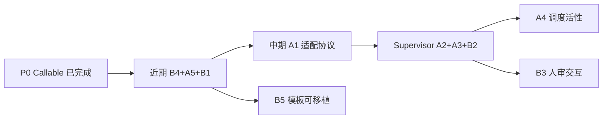

# Supervisor 与平台演进需求包

> **状态**: 草案（基于 2026-05-29 源码与三方对比综合）  
> **受众**: 架构评审、实现排期、验收测试  
> **语言**: 文档中文；代码/标识符/需求 ID 英文

## 一句话

将 [三方对比综合](../../research/agent_orchestration_comparison/04_synthesis_vs_acc.md) 中的 **A1–A5 / B1–B5** 借鉴项与 **四条非目标**，拆解为贴合当前 ACC 契约、可验收、可 feature-flag 的正式需求规格。

## 阅读顺序

| 顺序 | 文档 | 内容 |
|------|------|------|
| 0 | [00_principles_and_constraints.md](00_principles_and_constraints.md) | 第一性原理、ACC 护城河、非目标、横切健壮性 |
| 1 | [01_phase_near_term.md](01_phase_near_term.md) | **近期**: B4 强校验 + A5 日志分层 + B1 渐进披露 |
| 2 | [02_phase_adapter_protocol.md](02_phase_adapter_protocol.md) | **中期**: A1 统一外部 agent 适配契约 |
| 3 | [03_phase_supervisor.md](03_phase_supervisor.md) | **Supervisor**: A2 roster/路由 + A3 确定性兜底 + B2 决策审计 |
| 4 | [04_phase_scheduling_liveness.md](04_phase_scheduling_liveness.md) | A4 调度收敛、活性、恢复（与 03 交叉引用） |
| 5 | [05_ux_interactions.md](05_ux_interactions.md) | B3 human-in-the-loop 原语 |
| 6 | [06_template_portability.md](06_template_portability.md) | B5 模板导出/导入与技能附件 |
| — | [TRACEABILITY.md](TRACEABILITY.md) | 需求 ID ↔ 借鉴来源 ↔ ACC 模块 ↔ 验收索引 |

## 与已完成 P0 的衔接

P0 已落地（证据见 `docs/codex_goal_callable_semantics/MIGRATION_NOTES.md`）：

- `CallableInvocationService`（`acc/app/invocation.py`）
- `CallableWorkflowBundle`（`acc/app/bundle.py`）
- `.accflow.json` canonical + `ACC_USE_CALLABLE_DISPATCH` opt-in
- `ScopeFrame` / `SessionInstance` / `FunctionInvocation` 领域类型（`acc/domain.py`）
- GraphOps validate/dry-run API（`acc/graphops.py`, `acc/server/routes/graphops.py`）

本需求包 **不重复定义 P0**，仅在各阶段需求中标注 **依赖 P0** 与 **在 P0 之上的增量**。

## 上游参考

| 文档 | 用途 |
|------|------|
| [04_synthesis_vs_acc.md](../../research/agent_orchestration_comparison/04_synthesis_vs_acc.md) | 借鉴项来源（A1–B5、非目标、路线图） |
| [CURRENT_ARCHITECTURE.md](../../CURRENT_ARCHITECTURE.md) | ACC 当前架构契约 |
| [AGENTS.md](../../../AGENTS.md) | 不变量、测试、分层边界 |
| [GRAPHOPS_CONTROL_PLANE.md](../../concepts/GRAPHOPS_CONTROL_PLANE.md) | GraphOps 治理语义 |
| [callable MIGRATION_NOTES.md](../../codex_goal_callable_semantics/MIGRATION_NOTES.md) | Callable 迁移与 flag |

## 需求统计（草案）

| 阶段 | 需求条数 | 优先级分布 |
|------|----------|------------|
| principles | 8 | 约束/非目标 |
| near | 8 | P0: 6, P1: 2 |
| adapter | 5 | P0: 2, P1: 3 |
| supervisor | 9 | P0: 4, P1: 5 |
| scheduling | 5 | P1: 5 |
| ux | 4 | P1: 4 |
| template | 4 | P2: 4 |
| **合计** | **43** | 见 TRACEABILITY |

## 建议实施顺序

1. **近期**：不动 supervisor，强化校验与可观测（ROI 最高）。
2. **中期 A1**：为多 backend / resume / 流式打协议基础。
3. **Supervisor 栈**：A2+A3+B2 同批设计，A4 调度与 B3 交互可并行但依赖 A2 产出 wakeup 契约。
4. **B5**：可与近期并行，优先级低于 B4/B1。

## 文档维护

- 实现前若代码与「当前 ACC 现状」列冲突，**以代码为准**并回写本包。
- 新增需求必须分配唯一 `REQ-*` ID 并更新 [TRACEABILITY.md](TRACEABILITY.md)。
