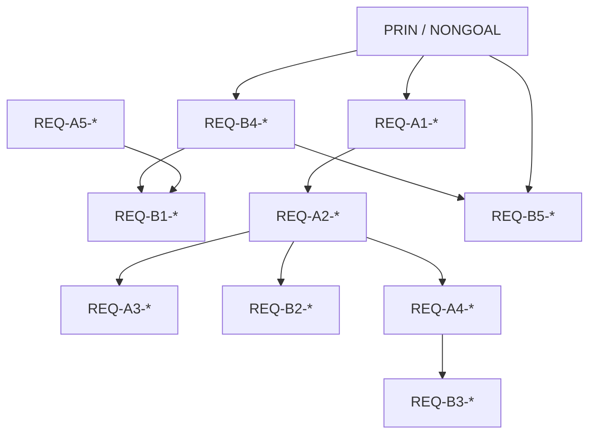

# 追溯矩阵：需求 ID ↔ 借鉴来源 ↔ ACC 模块 ↔ 验收

> 统计日期：2026-05-29  
> 需求总数：**43**（principles 8 + near 8 + adapter 5 + supervisor 9 + scheduling 5 + ux 4 + template 4）

## 借鉴项覆盖

| 借鉴项 | 需求 ID | 阶段文档 |
|--------|---------|----------|
| **A1** 统一 adapter 契约 | REQ-A1-001 ~ 005 | [02](02_phase_adapter_protocol.md) |
| **A2** Supervisor 三件套 | REQ-A2-001 ~ 005 | [03](03_phase_supervisor.md) |
| **A3** LLM 只产计划 | REQ-A3-001 ~ 004 | [03](03_phase_supervisor.md) |
| **A4** 调度/活性/恢复 | REQ-A4-001 ~ 005 | [04](04_phase_scheduling_liveness.md) |
| **A5** 日志分层 | REQ-A5-001 ~ 002 | [01](01_phase_near_term.md) |
| **B1** 渐进披露 | REQ-B1-001 ~ 003 | [01](01_phase_near_term.md) |
| **B2** 决策审计 | REQ-B2-001 ~ 002 | [03](03_phase_supervisor.md) |
| **B3** human-in-the-loop | REQ-B3-001 ~ 004 | [05](05_ux_interactions.md) |
| **B4** 强校验 dry-run | REQ-B4-001 ~ 005 | [01](01_phase_near_term.md) |
| **B5** 模板可移植 | REQ-B5-001 ~ 004 | [06](06_template_portability.md) |
| **非目标 §四** | REQ-NONGOAL-001 ~ 004 | [00](00_principles_and_constraints.md) |
| **护城河 §二** | REQ-PRIN-001 ~ 008 | [00](00_principles_and_constraints.md) |

## 完整需求索引

| ID | 标题 | 优先级 | 阶段 | 主要 ACC 模块 | 验收类型 |
|----|------|--------|------|---------------|----------|
| REQ-PRIN-001 | 无状态可复用类 | P0 | principles | `acc/domain`, `acc/registry` | 评审 + validate |
| REQ-PRIN-002 | 显式数据流 | P0 | principles | `acc/store`, `acc/engine` | 集成测试 |
| REQ-PRIN-003 | GraphOps 治理 | P0 | principles | `acc/graphops`, `acc/server/routes/graphops` | unit graphops |
| REQ-PRIN-004 | Feature flag | P0 | principles | `acc/app/__init__.py` | pytest flag on/off |
| REQ-PRIN-005 | Hermetic 测试 | P0 | principles | `acc/engine` | pytest |
| REQ-PRIN-006 | 分层边界 | P0 | principles | 全仓 | import boundaries |
| REQ-PRIN-007 | stdout JSON | P0 | principles | `acc/cli` | CLI 契约测试 |
| REQ-PRIN-008 | 无 DB | P0 | principles | — | 架构评审 |
| REQ-NONGOAL-001 | 无重量级控制面 | P0 | principles | — | 评审 |
| REQ-NONGOAL-002 | 无有状态 agent 实体 | P0 | principles | `acc/domain` | 评审 + export |
| REQ-NONGOAL-003 | 无黑板/内联 agent | P0 | principles | `acc/engine` | 评审 |
| REQ-NONGOAL-004 | 无纯涌现编排 | P0 | principles | `acc/app/supervisor`（新） | 评审 + E2E |
| REQ-B4-001 | 端口绑定完整性 | P0 | near | `acc/engine` | unit + CLI validate |
| REQ-B4-002 | 引用存在性 | P0 | near | `acc/app`, `acc/registry` | unit |
| REQ-B4-003 | 端口类型匹配 | P1 | near | `acc/engine` | unit |
| REQ-B4-004 | dry-run 执行计划 | P0 | near | `acc/engine`, `acc/cli` | CLI + unit |
| REQ-B4-005 | API save 校验 | P0 | near | `acc/server/routes/workflows` | server test |
| REQ-A5-001 | 事件/日志分离 | P1 | near | `acc/events`, `acc/runner` | unit + run |
| REQ-A5-002 | logRef/excerpt | P1 | near | `acc/run_index` | API + index |
| REQ-B1-001 | Inspector 三层 | P0 | near | `web/WorkflowViewer` | vitest |
| REQ-B1-002 | API 投影字段 | P0 | near | `acc/server/routes/runs` | server test |
| REQ-B1-003 | run-scoped 事件轮询 | P1 | near | `web/`, `acc/server` | vitest |
| REQ-A1-001 | AgentCapabilities | P0 | adapter | `acc/domain` | unit |
| REQ-A1-002 | Adapter 协议扩展 | P0 | adapter | `acc/adapters/*` | unit |
| REQ-A1-003 | Callable 能力调度 | P1 | adapter | `acc/app/invocation` | integration |
| REQ-A1-004 | capsule.yaml 映射 | P1 | adapter | `acc/registry`, `schemas` | unit |
| REQ-A1-005 | legacy 路径一致 | P1 | adapter | `acc/app`, `legacy_compat` | integration |
| REQ-A2-001 | SupervisorRoster | P0 | supervisor | `acc/app`, `acc/control_plane` | unit |
| REQ-A2-002 | DynamicInvocationIntent | P0 | supervisor | `acc/domain`, `acc/engine` | schema test |
| REQ-A2-003 | 协议注入 | P0 | supervisor | `acc/prompting`, templates | unit |
| REQ-A2-004 | SupervisorRouter | P0 | supervisor | `acc/app/invocation` | integration |
| REQ-A2-005 | 去重防环 | P0 | supervisor | `acc/app`, `acc/store` | unit |
| REQ-A3-001 | SupervisorPlan | P0 | supervisor | `acc/domain`, `acc/store` | unit |
| REQ-A3-002 | Proposal + GraphOps | P1 | supervisor | `acc/graphops` | graphops test |
| REQ-A3-003 | 批准计划执行 | P0 | supervisor | `acc/app` | integration |
| REQ-A3-004 | 数据驱动边界 | P1 | supervisor | `acc/engine` | unit |
| REQ-B2-001 | supervisor_decision 事件 | P0 | supervisor | `acc/store`, `acc/domain` | run artifact |
| REQ-B2-002 | decision 语义 | P0 | supervisor | `acc/engine` | schema |
| REQ-A4-001 | Wakeup 队列 | P1 | scheduling | `acc/app`, `acc/store` | unit + recovery |
| REQ-A4-002 | Ready-queue | P1 | scheduling | `acc/app` | integration flag |
| REQ-A4-003 | 健康判定 | P1 | scheduling | `acc/store`, manifests | unit |
| REQ-A4-004 | 三级恢复 | P1 | scheduling | `acc/app`, `acc/cli` | integration |
| REQ-A4-005 | WorkbenchRunManager | P2 | scheduling | `acc/server/run_manager` | server test |
| REQ-B3-001 | InteractionRequest | P1 | ux | `acc/domain` | schema |
| REQ-B3-002 | interactions API | P1 | ux | `acc/server` | server test |
| REQ-B3-003 | Workbench 卡 | P1 | ux | `web/` | vitest |
| REQ-B3-004 | human_gate 对齐 | P2 | ux | `acc/app`, workflows | integration |
| REQ-B5-001 | 导出包 | P2 | template | `acc/app`（新） | CLI |
| REQ-B5-002 | 导入纯净性 | P2 | template | `acc/engine`, `acc/app` | CLI |
| REQ-B5-003 | Skill 附件 | P2 | template | `acc/domain`, capsules | unit |
| REQ-B5-004 | lineage | P2 | template | metadata | unit |

## 主要代码 Gap（相对本需求包）

| Gap | 现状证据 | 阻塞需求 |
|-----|----------|----------|
| 无 `AgentCapabilities` / adapter capabilities() | `acc/adapters/base.py` 仅 `run()` | A1-* |
| 无 `SupervisorPlan` / `DynamicInvocationIntent` | `acc/domain.py` 无类型 | A2-*, A3-* |
| 无 `WakeupRequest` / 文件队列 | 仅 level-gather + 进程内 deque | A4-* |
| 无 `InteractionRequest` | 仅 GraphOps decisions UI | B3-* |
| 无 template bundle import/export | 仅 conductor export | B5-* |
| GraphOps apply 非 MVP 完整 | `graphops.py:137-138` **需确认** | A3-002 |
| `validate` 未传 registry known refs | `validate_clean_workflow_file` | B4-002 |
| 节点 API 无 output_preview/steps | `runs.py:44-49` | B1-002 |
| save API 是否 pre-validate | **需确认** `workflows.py` | B4-005 |
| run events API | **需确认** `runs.py` 余下路由 | B1-003 |

## 需确认探查命令

```bash
rg "validate_clean|validate_for_save" acc/server/routes/workflows.py
rg "events" acc/server/routes/runs.py
rg "apply_patch_request|human-approved" acc/graphops.py
rg "human_gate|supervisor" acc/ web/
```

## 建议测试映射

| 需求组 | 测试位置 |
|--------|----------|
| B4 | `tests/unit/test_callable_*`, `tests/server/test_workflows_api.py` |
| A5/B1 | `tests/server/test_runs*.py`, `web/src/App.test.tsx` |
| A1 | `tests/integration/test_callable_agent_backend.py` |
| A2/A3/B2 | 新 `tests/integration/test_supervisor_*.py` |
| A4 | 新 `tests/unit/test_wakeup_queue.py` |
| B3 | 新 `tests/server/test_interactions_api.py` |
| B5 | 新 `tests/unit/test_template_bundle.py` |

## 依赖图（需求级）



## 变更记录

| 日期 | 变更 |
|------|------|
| 2026-05-29 | 初版：基于 P0 代码与 04_synthesis 拆解 43 条 REQ |
