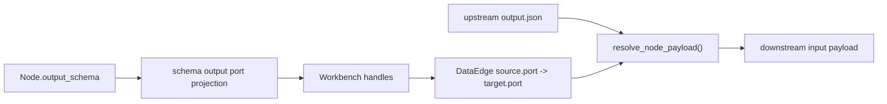

# Schema-Driven Ports And Adaptive Data Connections

## 目标

让 Workbench 的数据端口真正来自 `output_schema`，并让用户通过画布拖拽完成数据传递：

- `output_schema` 定义了哪些结构化输出，节点上就自动出现哪些 output data ports。
- 用户从某个 output data port 拖线到下游节点时，系统自动在下游节点创建一个 input data port。
- 只连 control edge 时，默认把上游完整 `main` output 传给下游 `main` input。
- 如果用户不想全量传递，就关闭上游节点的 full-output forwarding，再用手动 data edge 精确传递字段。
- 不新增状态机，只维护现有 `ControlEdge` / `DataEdge` / `PortContract` / `NodeControlPolicy` / payload resolution 机制。

## 当前代码事实

关键路径：

- `acc/models.py`
  - `ControlEdge` 只表示节点 readiness，当前 `context` 类型只有 `"none"`。
  - `DataEdge` 表示 `source node.port -> target node.port` 的显式数据移动。
  - `NodeControlPolicy.forward_main_output_on_control` 已经存在，用于控制 control edge 是否默认转发 `main` output。
  - `NodeInvocationSpec.output_schema`、`input_ports`、`output_ports` 已经是模板模型的一部分。

- `acc/runtime/node_payload.py`
  - `resolve_node_payload()` 的优先级是 static input、workflow input、node input bindings、data edges、control-main default forwarding。
  - `should_forward_main_output_on_control()` 默认允许 control edge 转发 `main` output，除非 source node 显式设置为 `False`。
  - `output_value_for_port()` 已支持 `output["outputs"][port_id]` 和 legacy top-level `output[port_id]`。

- `acc/engine/workflow_validation.py`
  - 当前会检查非 `main` output port 是否被 `output_schema` 声明。
  - 但 output port 仍主要是手动维护字段，容易和 `output_schema` 漂移。

- `web/src/components/WorkflowViewer.tsx`
  - 已有 control/data 两种连接模式。
  - 已有 data edge 创建逻辑、自动补 control dependency、自动新增 input port 的函数。
  - 但 output ports 仍主要来自节点上的 `outputPorts` 数组，而不是稳定地从 `outputSchema` 投影。

## 核心判断

推荐方案是：

```text
output ports = output_schema 的投影
input ports = 用户连接行为生成的消费别名
control edge = readiness + 可关闭的 main 全量默认传递
data edge = 精确字段传递
```

这比“手动维护 output ports”更稳，因为数据端口和运行时结构化输出契约来自同一个来源，减少重复状态和漂移。

## 设计原则

### 1. `output_schema` 是输出契约源头

Agent 真正能稳定产出的内容由 `output_schema` 约束。output data ports 只是这个契约在 UI 上的可视化投影。

因此，用户不应该先手动添加 output port，再另外维护 schema。正确顺序是：

```text
编辑 output_schema
  -> 系统推导 output ports
  -> 用户拖拽 output ports 建 data edges
  -> runtime 按 schema/port 映射取值
```

### 2. `main` 永远表示完整输出

`main` data port 的语义是“整个 `output.json`”。它不是 `output_schema` 中某个字段。

这让 control-only 流程有一个稳定默认行为：

```text
A --control--> B

如果 A.forward_main_output_on_control != false
且 B.main 没有被显式 input/data 填充
则 B.main = A 的完整 output
```

### 3. 非 `main` output ports 表示结构化字段

新设计下，推荐 schema 形态是：

```json
{
  "type": "object",
  "properties": {
    "outputs": {
      "type": "object",
      "properties": {
        "valuation_conclusion": {
          "type": "string",
          "description": "估值结论，而不是估值方法说明"
        },
        "risk_watchlist": {
          "type": "array",
          "items": { "type": "string" },
          "description": "后续监控风险"
        }
      },
      "required": ["valuation_conclusion"],
      "additionalProperties": false
    }
  },
  "required": ["outputs"],
  "additionalProperties": false
}
```

UI 生成：

```text
main                  -> json path: /
valuation_conclusion  -> json path: /outputs/valuation_conclusion
risk_watchlist        -> json path: /outputs/risk_watchlist
```

Legacy top-level schema 可以继续兼容，但新 UI 应优先引导用户使用 `outputs` 容器，避免把 `status`、`summary` 这类 envelope 字段误当成业务数据端口。

### 4. 输入端口由连接生成

下游节点的 input data port 本质是“这个节点要用什么 key 接收上游数据”。它不应该要求用户预先手动定义。

推荐交互：

```text
用户从 A.outputs.valuation_conclusion 拖线
  -> 放到 B 节点主体或 B 输入区域
  -> 系统创建 B.valuation_conclusion input port
  -> 系统创建 DataEdge:
     A.valuation_conclusion -> B.valuation_conclusion
```

如果 B 已经有同名 input port：

- 没有连接时，直接复用。
- 已有连接且 cardinality 是 `one`，提示替换或生成唯一端口名。
- cardinality 是 `many`，允许追加。

### 5. 不新增状态机

本需求不需要新的 runtime state machine。只需要新增“投影”和“规范化”：

- `output_schema -> output ports` 是 projection。
- schema 变化导致 edge 失效，是 validation/projection issue，不是新状态。
- input port 自动创建后仍落到现有 `PortContract` / `DataEdge` 模型。
- control-only 默认传递继续走现有 `control_main_default` binding record。

## 推荐数据流



运行时取值：

```text
source port main
  -> entire output.json

source port <field>
  -> output.outputs[<field>]
  -> fallback: output[<field>] for legacy compatibility
```

下游接收：

```text
target port <input_key>
  -> payload[<input_key>] = selected upstream value
```

## 用户体验规则

### 默认简单模式

用户只画 control edge：

```text
A --control--> B
```

效果：

- B 等 A 完成后再运行。
- 如果 A 没有关闭 full-output forwarding，B 会收到 A 的完整 output 到 `main`。
- 适合“我不想精细拆字段，只想让后续节点看到上游结果”的场景。

### 精确数据模式

用户关闭 A 的 full-output forwarding，然后手动拖 data edge：

```text
A.outputs.valuation_conclusion --data--> B.valuation_conclusion
A.outputs.risk_watchlist       --data--> B.risk_watchlist
A --control--> B
```

效果：

- control edge 只决定执行顺序。
- B 只收到显式 data edges 传来的字段。
- 适合“下游只需要高价值压缩数据，不要上游完整上下文”的场景。

### 当前架构边界

`forward_main_output_on_control` 目前是 source node 级开关，不是单条 edge 级开关。

因此当前可表达：

```text
A 对所有 control 下游都全量传递
或
A 对所有 control 下游都不全量传递
```

当前不能精确表达：

```text
A 对 B 全量传递，但对 C 不全量传递
```

如果后续强需求出现，可以复用已有 `ControlEdge.context` 扩展 edge 级语义；本轮不建议做，避免扩大状态面。

## Schema Projection 规则

### P0 规则

1. `main` 总是存在，表示完整 output。
2. 如果 `output_schema.properties.outputs.properties` 存在：
   - 每个 property 生成一个 output port。
   - `required` 来自 `outputs.required`。
   - `description` 用作 UI label/tooltip。
   - `type` 从字段 schema 推导，无法推导则用 `artifact` / `data`。
   - `json_path = /outputs/<field>`。
3. 如果没有 `outputs.properties`，但存在 legacy `output_ports`：
   - 保留 legacy ports，继续用现有校验规则兜底。
4. 如果只有 top-level properties：
   - Runtime 继续支持。
   - UI 可展示 schema fields，但新建 output data ports 不默认全部展开为 ports。

### 为什么不默认把所有 top-level fields 都变成 ports

很多 agent schema 会有：

```text
status
summary
confidence
limitations
```

这些字段可能是报告 envelope 或质量元数据，不一定是下游业务输入。全部变端口会制造噪音。

因此新工作流应使用 `outputs` 容器表达“可连接的业务输出”。legacy top-level 只做兼容。

## 持久化规则

推荐保存策略：

- `output_schema` 是 source of truth。
- `output_ports` 可以作为兼容 snapshot 写入 `.accflow.json`。
- 保存前由 normalization 重新从 schema 生成 agent output ports，避免漂移。
- 如果手动 `output_ports` 和 schema projection 不一致：
  - schema projection 优先。
  - 产生 validation warning。
  - 已连接到不存在 schema field 的 data edge 标记为 broken/error。

Input ports 不从 schema 生成。它们来自用户连接，仍作为 `input_ports` 持久化。

## 风险 / 边界

1. Schema 改名会影响既有 data edge。
   - 需要在 UI 和 validator 中把 edge 标为 broken，不能静默删除。

2. Source node 级 full-output forwarding 粒度较粗。
   - 当前足够匹配“全量或精确”两种模式。
   - edge 级 forwarding 是 P2，不放入本轮核心。

3. 大 output 通过 control-only 全量传递可能拖慢 prompt / payload。
   - 这是用户选择 full-output forwarding 的代价。
   - UI 应提示：需要压缩上下文时关闭全量传递并使用 data edge。

4. Workflow container 的 output ports 不能只看内部 agent schema。
   - Workflow 的输出仍由 `workflow_output_bindings` / `exposed_outputs` 决定。
   - 内部 agent schema ports 只有通过 boundary data edge 连接到 Workflow Outputs 后，才成为 workflow output。

## JSON Schema 支持矩阵

| Schema 形态 | P0 行为 |
| --- | --- |
| `properties.outputs.properties.<field>` | 生成一级 output data port |
| `properties.outputs.required` | 映射到 port required metadata |
| `description` / `title` | 用于 tooltip / inspector |
| nested object field | 作为一个一级 port，不递归展开 |
| array field | 作为一个一级 port；可标记 `many`，但不改变 runtime 聚合语义 |
| `additionalProperties` | 不生成动态 ports；只投影 explicit properties |
| `$ref` / `$defs` | P0 不解析；给 diagnostic，不 crash |
| `anyOf` / `oneOf` / `allOf` | P0 不解析；给 diagnostic，不 crash |
| legacy top-level `properties.<field>` | runtime 兼容；UI 不默认生成新业务端口 |

## Failure Policy

| 失败场景 | 处理方式 |
| --- | --- |
| schema field removed but edge still references it | validate 返回 `dangling_data_edge_source`，UI 保留 broken edge |
| target input port missing | validate 返回 `dangling_data_edge_target`，UI 提供创建 input port 修复入口 |
| required input has no source | validate 返回 `unbound_input_port` |
| explicit data edge source value missing at runtime | 当前节点 failed，并记录 failure evidence |
| output.json violates output_schema | 当前节点 failed，并记录 schema validation error |
| schema projection cannot parse complex schema safely | 保留 `main`，给 diagnostic，不让 UI 生成不可信端口 |

Broken/stale port 不是 runtime state。它是由当前 template、schema 和 edge 派生出来的 validation/projection 结果。

## 产品完成定义

这个需求的完成定义不是“节点上能显示端口”，而是：

1. 用户能从 schema-derived output port 拖线到下游 node body。
2. 系统能自动创建 target input port 和 `DataEdge`。
3. 用户能保存、刷新、重新打开后看到同样的数据连接。
4. 运行后能在下游 input evidence 里看到显式 data edge 传来的字段。
5. 关闭 full-output forwarding 后，下游不会偷偷收到完整 `main` output。
6. schema 字段改名后，broken edge 可见、可解释、可修复。
