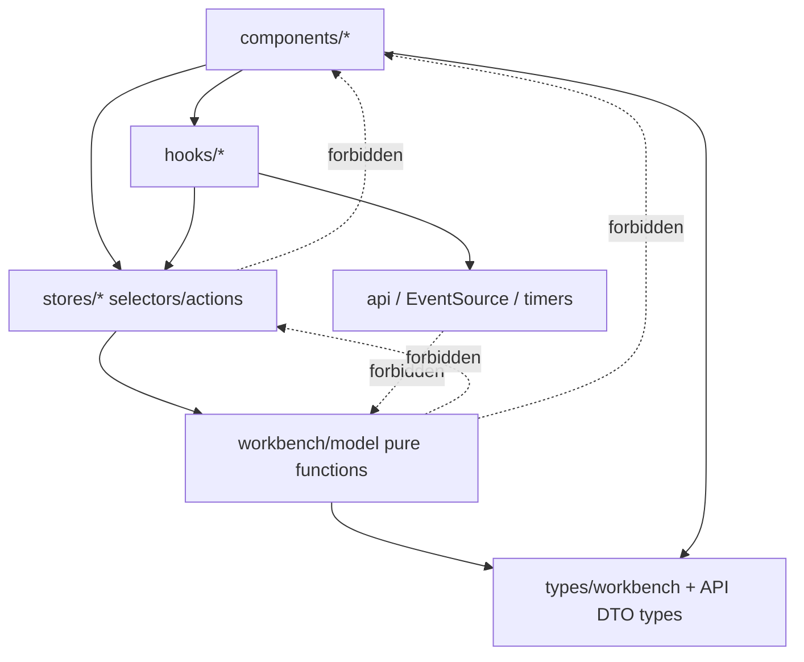

# WorkflowViewer.tsx 重构专项方案

日期：2026-06-19  
范围：`web/src/components/WorkflowViewer.tsx` 及其 Workbench 前端拆分边界  
状态：设计方案，基于当前工作区真实代码与两个 clean-context subagent 只读审计结论汇总

## 1. 结论摘要

当前 `WorkflowViewer.tsx` 不是项目契约中描述的 thin shell，而是 Workbench 前端的事实 God Component。它同时承担：

- Workbench task/canvas/selection/chrome 状态容器。
- ReactFlow canvas 渲染、拖拽、连线、handle 投影、focus workflow 投影。
- canvas 和 canonical graph 双向转换。
- workflow boundary transfer、data edge、control edge 的 UI 投影逻辑。
- run submit、polling、SSE、run evidence、live event 合并。
- assistant session、assistant turn stream、GraphOps proposal/dry-run/apply。
- inspector、execution dock、assistant drawer、demo canvas factory、test helper barrel。

最优重构方向不是继续随手抽组件，而是重新确立前端分层与 source of truth：

```text
components -> hooks/effects -> stores -> workbench/model -> types
hooks/effects -> api
```

核心目标：

- `WorkflowViewer.tsx` 最终缩到小于 300 行，只负责启动、布局组合和 props-to-store 初始化。
- `workbench/model` 成为纯函数层，不依赖 React、Zustand、API、DOM、ReactFlow。
- `stores` 成为前端交互投影的唯一 owner，但不成为 durable truth。
- `hooks/effects` 是唯一可以调用 API、EventSource、timer、runner 的前端层。
- ReactFlow 组件只做渲染与局部 pointer/viewport transient state，不再持有 graph 语义。
- 测试从具体模块 import，不再通过 `WorkflowViewer.tsx` 的巨型导出列表拿 helper。

这是一个架构治理修复，不是一次普通组件拆分。

## 2. 当前事实基线

基于当前工作区文件：

| 项 | 当前事实 |
| --- | --- |
| 主文件 | `web/src/components/WorkflowViewer.tsx` |
| 文件大小 | 745,328 bytes |
| 行数 | 约 21,302 行 |
| `useState` | 约 79 处 |
| `useEffect` | 约 42 处 |
| `useCallback` | 约 52 处 |
| `useRef` | 约 29 处 |
| `api.*` 调用 | 约 51 处 |
| ReactFlow 实现 | 仍在 `WorkflowViewer.tsx` 内 |
| Zustand stores | 已存在，但基本未被消费 |
| wrapper/re-export | 多个文件仍从 `WorkflowViewer.tsx` 回导实现 |

主要代码段：

| 代码段 | 起止行 | 规模 | 现状 |
| --- | ---: | ---: | --- |
| `WorkflowViewer` 主组件 | `2381-5225` | 2,845 行 | 全局状态、API effects、运行/assistant/任务协调 |
| `ExecutionDock` | `5226-5545` | 320 行 | 本地实现仍在主文件 |
| `AssistantDrawer` | `5546-6432` | 887 行 | 本地实现仍在主文件 |
| `AssistantDockContent` | `6433-7227` | 795 行 | 本地实现仍在主文件 |
| `WorkspaceCanvas` | `7228-8499` | 1,272 行 | ReactFlow canvas 核心仍在主文件 |
| `WorkflowContainer` | `8500-8920` | 421 行 | workflow 节点渲染仍在主文件 |
| `AgentToolNode` | `8921-9713` | 793 行 | agent/tool 节点渲染仍在主文件 |
| `SelectionDetailsDock` | `9969-11367` | 1,399 行 | 本地实现仍在主文件 |
| `DataConnectionsPanel` | `12467-15613` | 3,147 行 | inspector/data connection 大块逻辑 |
| `graphToWorkspaceCanvas` | `15614-15792` | 179 行 | 纯模型转换仍在主文件 |
| `canvasToWorkflowGraph` | `15793-16698` | 906 行 | 纯模型转换仍在主文件 |
| `workspaceDemoCanvas` | `16699-20379` | 3,681 行 | demo fixture/factory 仍在主文件 |
| `addCallableNodeFromPalette` | `20380-21234` | 855 行 | palette -> canvas mutation 仍在主文件 |
| 巨型 export block | `21235-21302` | 68 行 | 测试和 wrapper 依赖主文件 |

历史上确实做过拆分尝试：

- `ef6ec69`：install Zustand, extract canvas + authoring modules。
- `c672a86`：extract assistant, execution, inspector modules + SSE hooks。
- `9ccf7f6`：commit message 声称 compress to thin shell。
- 后续 `98db86a`、`1a74f49`、`87d9f22` 又把大量功能压回 `WorkflowViewer.tsx`。

因此当前状态不是“未重构”，而是“重构启动后没有完成 source-of-truth 迁移，随后继续在主文件堆功能”。

## 3. 与项目契约的偏差

项目契约要求：

- `WorkflowViewer.tsx` 是 thin shell importing sub-modules。
- `web/` 只负责 interaction state 和 visual projection。
- UI task state 是 projection；workflow templates 和 run artifacts 才是 durable truth。
- 多个并发 run 必须通过 `run_id + task_id` 建模，不能有全局 `isRunning` singleton。
- Workbench 语义不能越过后端 canonical compiler。

当前偏差：

1. `WorkflowViewer.tsx` 是全局状态容器，不是 thin shell。
2. `canvas`、`sourceGraph`、`tasks[].canvas` 三份状态并存，需要调用方知道该用 `updateCanvas` 还是 `updateCanvasAndGraph`。
3. run state 仍由主组件推导 `selectedRunId` / `isRunning`，并发 run 建模不够强。
4. boundary transfer、data edge、control edge、graph projection 等语义散在主组件中。
5. 已抽出的 `stores`、`hooks`、`components` 很多没有成为真实 owner。
6. 多个 wrapper 文件从 `WorkflowViewer.tsx` re-export，制造了看似模块化、实际反向依赖的结构。

## 4. 第一性原则

### 4.1 Durable Truth 不在前端

前端只能拥有当前交互投影：

- 当前 task 的 canvas view model。
- selection、viewport、panel、connection mode 等 UI 状态。
- run evidence 的投影缓存。
- assistant authoring 的交互状态。

Durable truth 仍然是：

- canonical workflow template。
- run record、events、behavior snapshots、artifacts。
- 后端 canonical compiler 的 validation/preview 结果。

因此前端 store 不能被设计成业务真相，只能是可重建、可丢弃、可从后端事实恢复的 projection cache。

### 4.2 语义先纯化，再组件化

如果先移动 React 组件，而 graph/canvas/edge/run/assistant 语义仍藏在组件闭包里，会得到更多 wrapper 和 prop drilling。正确顺序是：

1. 抽类型和常量。
2. 抽无副作用纯函数。
3. 抽 effect hooks。
4. 接入 store ownership。
5. 最后迁 ReactFlow 和 UI 组件。

### 4.3 后端是 canonical semantic judge

特别是 workflow boundary control transfer：

- UI 只能表达边界控制线、metadata、端口意图。
- 后端 compiler 才是 `workflow_input_bindings` / `workflow_output_bindings` 的权威裁判。
- 前端 preview 可以展示后端返回结果，不能伪造成功 binding。
- boundary control edge 不应进入 runtime `control_edges`。

### 4.4 并发运行必须按 runId 建模

前端状态必须允许多个 task、多个 run、多个 stream 并存：

- `runsById[runId]` 是 run 投影主表。
- `runIdsByTaskId[taskId]` 是 task 到 run 的索引。
- `activeRunIdsByTaskId[taskId]` 或 selector 推导当前 task 的活跃运行。
- `nodeRunsByRunId[runId][nodeId]` 保存节点级投影。
- live logs 和 live events 必须按 `runId + nodeId` 分区。

不能让当前选中的 run 覆盖非选中 run 的 evidence 或 status。

## 5. 目标架构

### 5.1 推荐目录结构

建议新增 `web/src/workbench/` 作为 Workbench 纯模型和前端应用逻辑边界。不要继续把纯语义放到 `components/` 下。

```text
web/src/
  types/
    workbench.ts

  workbench/
    constants.ts
    model/
      taskModel.ts
      canvasProjection.ts
      canvasLayout.ts
      canvasEdgeOps.ts
      flowProjection.ts
      selectionModel.ts
      boundaryTransferProjection.ts
      runProjection.ts
      liveEvents.ts
      authoringProposal.ts
      graphOpsProposal.ts
    diagnostics/
      workbenchDiagnostics.ts

  stores/
    workbenchStore.ts
    runStore.ts
    assistantStore.ts
    resourceStore.ts

  hooks/
    useWorkbenchBootstrap.ts
    useTaskPersistence.ts
    useBoundaryTransferPreview.ts
    useRunSubmit.ts
    useRunStream.ts
    useWorkbenchLiveStream.ts
    useAssistantSession.ts
    useAssistantTurnStream.ts

  components/
    WorkflowViewer.tsx
    workbench/
      WorkbenchShell.tsx
      TopBar.tsx
      TaskRail.tsx
      TaskOverviewPage.tsx
      SaveWorkflowDialog.tsx
    canvas/
      WorkspaceCanvas.tsx
      CanvasToolbar.tsx
      NodeRenderer.tsx
      WorkflowContainer.tsx
      AgentToolNode.tsx
      WorkflowHeader.tsx
      WorkflowPortColumn.tsx
      ControlConnectHitbox.tsx
      WorkflowInternalEdgeLayer.tsx
    inspector/
      RightInspector.tsx
      NodeInspector.tsx
      WorkflowInspector.tsx
      EdgeInspector.tsx
      PortInspector.tsx
      DataConnectionsPanel.tsx
      SelectionDetailsDock.tsx
    execution/
      ExecutionDock.tsx
      RunOverlay.tsx
      LiveOutputViewer.tsx
      WorkflowEvidenceDock.tsx
    assistant/
      AssistantDrawer.tsx
      AssistantDockContent.tsx
      AssistantTurnList.tsx
      AssistantGraphOpsReview.tsx
    authoring/
      ProposalReview.tsx
```

### 5.2 依赖方向



强制规则：

- `workbench/model/*` 不 import React、Zustand、API、ReactFlow、DOM。
- `stores/*` 不 import React component，不 import ReactFlow。
- `hooks/*` 可以 import API、EventSource、store actions 和 pure model。
- `components/*` 不直接调用 `api.*`，除非是迁移期白名单。
- `WorkflowViewer.tsx` 不 export helper，不作为 test barrel。

## 6. Source Of Truth 设计

### 6.1 Workbench Store

`workbenchStore` 应成为前端 task/canvas/selection/chrome 的唯一 owner。

推荐结构：

```ts
type WorkbenchState = {
  tasksById: Record<string, WorkbenchTask>;
  taskOrder: string[];
  activeTaskId: string;
  canvasRevisionsByTaskId: Record<string, number>;
  selectionsByTaskId: Record<string, CanvasSelection>;
  chrome: WorkbenchChromeState;
  connectionMode: ConnectionMode;
  edgeViewMode: EdgeViewMode;
  focusedWorkflowIdByTaskId: Record<string, string | null>;
};
```

设计要点：

- 当前 task 的 canvas 只存在于 `tasksById[activeTaskId].canvas`。
- 不再保留并行的 `canvas`、`sourceGraph`、`tasks[].canvas` 三份权威状态。
- canonical graph 是 `canvasToWorkflowGraph(canvas)` 的派生结果；如需性能，按 `canvasRevision` 做 memo/cache，而不是变成第二份真相。
- task 持久化由 `useTaskPersistence` 处理，store action 不直接调用 API。

### 6.2 Run Store

`runStore` 应按 runId 分区。

推荐结构：

```ts
type RunState = {
  runsById: Record<string, RunProjection>;
  runIdsByTaskId: Record<string, string[]>;
  activeRunIdsByTaskId: Record<string, string | null>;
  nodeRunsByRunId: Record<string, Record<string, NodeRunSummary>>;
  liveLogsByRunAndNode: Record<string, Record<string, NodeLiveLogs>>;
  liveEventsByRunId: Record<string, BoundedRunEventBuffer>;
  runtimeConfig: RuntimeConfig | null;
  workflowBindings: Record<string, WorkflowBindingView>;
};
```

设计要点：

- `isRunning` 只能是 selector，例如 `isTaskRunning(taskId)`。
- run stream reducer 必须幂等，按 `event_id`、`seq` 或稳定 composite key 去重。
- terminal event、polling result、live event 可以乱序抵达，统一进入 `mergeRunProjection`。
- SSE subscription 应按 runId keyed，切换 selection 不应丢失非当前 run 的 evidence。

### 6.3 Assistant Store

`assistantStore` 应独立拥有：

- assistant session id。
- pending turn。
- assistant messages。
- proposal。
- backend validation。
- GraphOps review。
- required actions。
- apply undo token。
- temporary resources。

设计要点：

- assistant proposal 的类型只定义一次，不能在 `WorkflowViewer.tsx`、`AssistantDrawer.tsx`、`assistantStore.ts` 多处弱化复制。
- 普通 chat turn 和 canvas authoring turn 要用明确 `turnReason` 区分。
- 当前内联逻辑里 “只有非 `workbench_chat` 且 turn id 匹配时才 validate draft” 的条件必须保留。

### 6.4 Resource Store

建议引入轻量 `resourceStore` 管理：

- callable summaries。
- workflow summaries。
- runtime config cache。
- workflow bindings cache。
- authoring agents。

这些数据现在散在 `WorkflowViewer.tsx` props、state、effect 和 run store 之间。拆出来后，canvas、assistant、inspector 都通过 selector 消费同一份投影。

## 7. 纯模型模块职责

### 7.1 `types/workbench.ts`

集中定义：

- `WorkspaceCanvasModel`
- `WorkflowContainerModel`
- `InternalNodeView`
- `WorkflowCanvasEdge`
- `CanvasSelection`
- `WorkbenchTask`
- `RunProjection`
- `NodeRunSummary`
- `SelectedEntityDetailsModel`
- `BoundaryTransferPreviewView`
- `AssistantAuthoring*` view-model types

目的：

- 消除 stores/hooks/components 内的 mirror type。
- 让 extracted modules 不再从 `WorkflowViewer.tsx` import 类型。

### 7.2 `workbench/constants.ts`

集中定义：

- node size/layout constants。
- port spacing constants。
- inspector width limits。
- `TASK_STORE_KEY`。
- `DEFAULT_TASK_ID`。
- temporary callable prefixes。

当前主文件和 `canvasConstants.ts` 已出现 `TASK_STORE_KEY` 版本不一致风险，这类常量必须唯一。

### 7.3 `canvasProjection.ts`

职责：

- `graphToWorkspaceCanvas`
- `canvasToWorkflowGraph`
- `workflowGraphFromFocusCanvas`
- graph/canvas roundtrip normalization
- Workbench-only metadata 编解码

约束：

- 不直接调用 API。
- 不读写 localStorage。
- 不依赖 ReactFlow。
- boundary transfer 的 authoritative validation 不在这里完成；这里只做 Workbench graph projection。

### 7.4 `canvasEdgeOps.ts`

职责：

- `resolveScopedConnection`
- `createDataEdgeCommand`
- `createControlEdgeCommand`
- `canvasEdgesAreEquivalent`
- data/control edge duplicate detection
- port deletion/rename 对边的影响计算

必须保留的语义护栏：

- 显式 data edge 是数据传输真相。
- 已存在的非边界 `main -> main` data edge 必须继续渲染和保存。
- UI 创建新的非边界 `main -> main` data edge 是否允许，应由产品规则和后端 validation 双重约束；不能再靠 `isImplicitMainDataEdge` 这种端口名猜测隐藏真实边。
- boundary control transfer 不能变成 runtime control edge。

### 7.5 `boundaryTransferProjection.ts`

职责：

- Workbench edge metadata normalize。
- `boundary_transfer` snake_case 和旧 `boundaryTransfer` 兼容。
- preview API request payload 构造。
- preview response 映射为 inspector view model。
- `runtime_control_edge=false` 的 UI 展示。

明确不做：

- 不在前端伪造 valid binding。
- 不把后端 diagnostics 降级为本地 warning。

### 7.6 `flowProjection.ts`

职责：

- canvas nodes -> ReactFlow nodes。
- canvas edges -> ReactFlow edges。
- handle id encode/decode。
- root canvas 和 focused workflow canvas 的投影差异。
- edge view mode 过滤。

该模块可以依赖 ReactFlow 类型，但不依赖 React component。

### 7.7 `canvasLayout.ts`

职责：

- dagre layout。
- workflow container auto-size。
- internal node layout。
- focused workflow layout。
- layout collision/fit constraints。

约束：

- 输入输出都是 immutable model。
- 不直接 mutate ReactFlow nodes。

### 7.8 `selectionModel.ts`

职责：

- normalize selection。
- selected entity lookup。
- selected entity details model。
- delete selected object mutation command。
- selection after mutation 的确定性规则。

### 7.9 `runProjection.ts` 和 `liveEvents.ts`

职责：

- run record + run state + events -> `RunProjection`。
- node run lookup。
- node live logs append。
- bounded event buffer。
- out-of-order terminal event merge。
- evidence ownership view model。

### 7.10 `authoringProposal.ts` 和 `graphOpsProposal.ts`

职责：

- capture authoring snapshot。
- stable hash。
- deterministic proposal builder。
- proposal validation。
- proposal apply command。
- temporary resource -> GraphOps transaction。

约束：

- proposal apply 返回 patch/result，不直接 setState。
- GraphOps API 调用留在 hook。

## 8. 组件层目标

### 8.1 `WorkflowViewer.tsx`

最终职责：

- 接收 `callables`、`workflows` 等顶层 props。
- 初始化 resource/workbench store。
- 调用 bootstrap hooks。
- 组合 `WorkbenchShell`、`WorkspaceCanvas`、`RightInspector`、`ExecutionDock`、`AssistantDrawer`。
- 处理少量 route-level 或 app-level glue。

明确禁止：

- 不定义 canvas/graph 转换函数。
- 不定义 ReactFlow node renderer。
- 不直接调用 run/assistant API。
- 不导出 test helper。
- 不包含 demo canvas factory。

### 8.2 Canvas Components

`WorkspaceCanvas`：

- 持有 ReactFlow viewport、drag buffer、pointer transient state。
- 通过 store selectors 获取当前 canvas。
- 通过 action dispatch 提交 resolved mutation。
- 不做 graph canonical serialization。

`AgentToolNode` / `WorkflowContainer`：

- 只渲染 node data。
- handle id 和 port position 由 `flowProjection` / `canvasConstants` 提供。
- 不读写全局 task state。

### 8.3 Inspector Components

Inspector 应变成 view-model driven：

- `RightInspector` 根据 selection kind 分发。
- `NodeInspector` 显示 invocation、ports、run evidence。
- `WorkflowInspector` 显示 workflow exposed ports、boundary preview。
- `EdgeInspector` 显示 data/control/boundary transfer metadata。
- `DataConnectionsPanel` 调用 action，不直接操作 canvas nested structure。

### 8.4 Assistant Components

Assistant UI 只渲染：

- message list。
- proposal summary。
- validation diagnostics。
- GraphOps review。
- authoring controls。

session creation、turn submission、streaming、GraphOps apply 都放到 hooks。

### 8.5 Execution Components

Execution UI 只关心：

- 当前 task 是否可运行。
- 当前 run/run node 状态。
- runtime mode。
- run buttons。

提交 run、polling、streaming、cancel、evidence fetch 放到 hooks/store。

## 9. 现有技术债清单

### 9.1 Wrapper/Re-export 债

必须消除的反向依赖：

- `web/src/components/canvas/WorkspaceCanvas.tsx` 从 `../WorkflowViewer` re-export。
- `web/src/components/canvas/NodeRenderer.tsx` 从 `../WorkflowViewer` re-export。
- `web/src/components/canvas/CanvasEditor.tsx` 只建立边界但没有真实实现。
- `web/src/components/authoring/AuthoringSession.tsx` 从 `../WorkflowViewer` re-export authoring functions。
- `web/src/components/authoring/ProposalReview.tsx` 从 `../WorkflowViewer` re-export proposal functions。
- `WorkflowViewer.tsx` 的巨型 export block 让测试把主文件当公共库。

这些文件的存在本身不是问题，问题是依赖方向反了。目标是让 `WorkflowViewer.tsx` import 它们，而不是它们 import `WorkflowViewer.tsx`。

### 9.2 Store 影子状态债

当前 `workbenchStore.ts` 自己说明 full `WorkspaceCanvasModel` 和 `WorkbenchTask` 仍由 `WorkflowViewer` 拥有。`runStore.ts`、`assistantStore.ts` 也定义了状态，但搜索结果显示基本没有消费者。

这意味着 Zustand 已经存在，但没有接管 source of truth。后续不能继续复制 state type，而要一次性定义 ownership。

### 9.3 类型/常量镜像债

典型问题：

- `WorkflowStatus` 多处定义。
- `AssistantChatMessage` 多处定义。
- `CanvasAuthoringProposal` 多处弱化定义。
- `TASK_STORE_KEY` 主文件与 `canvasConstants.ts` 存在版本不一致风险。

必须通过 `types/workbench.ts` 和 `workbench/constants.ts` 收口。

### 9.4 编码和 i18n 债

部分已抽出的组件中可见中文 mojibake 文本，例如 `ExecutionDock.tsx`、`NodeDetailOverlay.tsx`。这说明拆分时不能只移动代码，还要把用户可见文本统一进 `i18n/zh-CN.ts` 或至少确保文件编码正确。

## 10. 分阶段实施方案

### 阶段 0：基线护栏

目标：确保后续每步拆分都有可比较基线。

写集合：

- `web/src/App.test.tsx`
- `web/src/components/WorkflowViewer.drag.test.tsx`
- 新增必要 fixture/test helpers

动作：

- 补齐 autosave 404 mock，降低迁移期间 stderr 噪声。
- 明确标记 boundary transfer、显式 data edge、focused workflow、drag/drop、assistant turn 的关键测试。
- 记录当前 `npx tsc --noEmit`、`npm run test -- --run`、`npm run build` 基线。

验收：

- `cd web && npx tsc --noEmit`
- `cd web && npm run test -- --run`
- 无非预期 console/test stderr 噪声。

### 阶段 1：类型和常量收口

目标：切断 extracted modules 依赖主文件类型的理由。

新增：

- `web/src/types/workbench.ts`
- `web/src/workbench/constants.ts`

迁移：

- `WorkspaceCanvasModel`
- `WorkflowCanvasEdge`
- `WorkflowContainerModel`
- `InternalNodeView`
- `CanvasSelection`
- `WorkbenchTask`
- `WorkbenchChromeState`
- `RunProjection`
- `NodeRunSummary`
- `SelectedEntityDetailsModel`
- layout constants
- `TASK_STORE_KEY`

验收：

- stores/hooks/components 不再定义 mirror type。
- `rg "from '../WorkflowViewer'" web/src/components` 只剩临时白名单。
- tsc/test 通过。

### 阶段 2：纯模型函数抽离

目标：把行为核心从 React 组件闭包里拿出来。

新增：

- `web/src/workbench/model/canvasProjection.ts`
- `web/src/workbench/model/canvasEdgeOps.ts`
- `web/src/workbench/model/boundaryTransferProjection.ts`
- `web/src/workbench/model/flowProjection.ts`
- `web/src/workbench/model/canvasLayout.ts`
- `web/src/workbench/model/selectionModel.ts`
- `web/src/workbench/model/taskModel.ts`

迁移：

- `graphToWorkspaceCanvas`
- `canvasToWorkflowGraph`
- `resolveScopedConnection`
- `createDataEdgeCommand`
- `isImplicitMainDataEdge`
- `workflowInputBindingsFromBoundaryEdges`
- `workflowOutputBindingsFromBoundaryEdges`
- layout functions
- selection deletion
- demo canvas factory 移到 fixture/model demo 文件，不再留主组件。

验收：

- 新增小单测覆盖 graph/canvas roundtrip、boundary metadata、data edge 规则、focused workflow。
- `WorkflowViewer.tsx` 可短期 re-export 这些函数，但测试必须开始迁到新模块。
- boundary transfer 和显式 data edge 现有测试不回退。

### 阶段 3：effect hooks 统一

目标：把 API、EventSource、timer 从组件里剥离。

新增/完善：

- `web/src/hooks/useWorkbenchBootstrap.ts`
- `web/src/hooks/useTaskPersistence.ts`
- `web/src/hooks/useBoundaryTransferPreview.ts`
- `web/src/hooks/useRunSubmit.ts`
- `web/src/hooks/useRunStream.ts`
- `web/src/hooks/useWorkbenchLiveStream.ts`
- `web/src/hooks/useAssistantSession.ts`
- `web/src/hooks/useAssistantTurnStream.ts`

关键要求：

- `useRunStream` 补齐主文件当前处理的 `live_event`。
- stream reducer 幂等，支持 seq gap refill。
- assistant stream 保留 authoring turn validation 条件。
- API error 转为稳定 diagnostics，不在组件里散落 `catch`。

验收：

- fake EventSource 单测。
- stream cleanup/cancel 单测。
- assistant 普通 chat turn 不触发 draft validation。
- run terminal event 乱序抵达时状态仍正确。

### 阶段 4：小型展示组件等价替换

目标：先替换低风险 UI，减少主文件体积。

迁移/替换：

- `ExecutionDock`
- `RunOverlay`
- `LiveOutputViewer`
- `NodeDetailOverlay`
- `SelectionDetailsDock`
- `WorkbenchShell`
- `TopBar`
- `TaskRail`
- `TaskOverviewPage`
- `TaskWorkspaceSwitcher`
- `SaveWorkflowDialog`

注意：

- 现有 extracted components 未必与内联版本等价，不能直接假设可替换。
- 先补齐 props、文案、按钮 disabled、evidence action、assistant body class。
- 修复中文 mojibake 或移入 i18n。

验收：

- UI snapshot/RTL test 通过。
- evidence dock、assistant dock、execution buttons 行为一致。
- tsc/test 通过。

### 阶段 5：Inspector 拆分

目标：把右侧 inspector 从主组件剥离。

新增：

- `web/src/components/inspector/RightInspector.tsx`
- `web/src/components/inspector/NodeInspector.tsx`
- `web/src/components/inspector/WorkflowInspector.tsx`
- `web/src/components/inspector/EdgeInspector.tsx`
- `web/src/components/inspector/PortInspector.tsx`
- `web/src/components/inspector/DataConnectionsPanel.tsx`
- `web/src/workbench/model/selectedEntityDetails.ts`

迁移原则：

- 先迁 view-model builder，再迁 UI。
- mutation 通过 store actions 或 callbacks，不在 inspector 内直接改 nested canvas。
- boundary preview 只消费 `useBoundaryTransferPreview` 结果。

验收：

- 选中 workflow/node/internal node/edge/port 均显示正确 inspector。
- 端口新增/删除/重命名不破坏 data edge。
- ambiguous boundary transfer error 能阻断运行并显示。

### 阶段 6：Assistant 和 GraphOps 拆分

目标：assistant UI、session lifecycle、authoring proposal、GraphOps flow 分层。

迁移：

- `AssistantDrawer`
- `AssistantDockContent`
- `AssistantGraphOpsReview`
- `ProposalReview`
- `authoringProposal.ts`
- `graphOpsProposal.ts`

验收：

- chat turn。
- canvas revision turn。
- selected node revision turn。
- temporary agent proposal。
- GraphOps validate/dry-run/approve/apply。
- undo token 行为。

### 阶段 7：ReactFlow Canvas 拆分

目标：最后迁移最敏感的 canvas rendering 和 interaction。

迁移顺序：

1. `flowProjection.ts`：nodes/edges/handles 投影。
2. `NodeRenderer.tsx`：`AgentToolNode`、`WorkflowContainer`。
3. `CanvasToolbar.tsx`。
4. `WorkspaceCanvas.tsx`：ReactFlow root、drag/drop、connect lifecycle。
5. `connectionHandlers.ts`、`dragDrop.ts`：事件处理从组件中进一步薄化。

关键护栏：

- ReactFlow `nodeTypes` 保持稳定引用。
- handle id 不随意改名。
- root canvas 和 focused workflow canvas 均通过同一 flow projection。
- data/control/all edge view mode 行为不变。
- 显式 `main -> main` data edge 可见，不被隐式边过滤吞掉。

验收：

- `WorkflowViewer.drag.test.tsx` 全绿。
- 拖入 callable。
- workflow 内外连 control/data edge。
- focused workflow 边界输入/输出。
- duplicate edge id 防护。
- canvas layout 不跳动。

### 阶段 8：Store Ownership 迁移

目标：让 stores 真正接管前端 projection state。

迁移：

- `workbenchStore` 持有 tasks/canvas/selection/chrome。
- `runStore` 持有 runs/logs/events/bindings/runtimeConfig。
- `assistantStore` 持有 session/proposal/review/undo。
- `resourceStore` 持有 callables/workflows/authoring agents。

关键动作：

- 删除主文件 `useState` 中对应状态。
- 删除 `canvas/sourceGraph/tasks[].canvas` 三份真相。
- 所有 mutation 变成 action + pure model command。
- 跨 store 派生用 selector hook，不让 store 互相深读。

验收：

- 多任务切换不丢 selection 和 canvas。
- 多 run 并发状态不互相覆盖。
- selection 切换不停止非当前 run 的 stream reducer。
- 本地 task state 不写入 workflow template runtime 字段。

### 阶段 9：收口清理

目标：完成 thin shell。

动作：

- 删除 `WorkflowViewer.tsx` 的巨型 export block。
- 删除 wrapper 中从 `WorkflowViewer.tsx` re-export 的逻辑。
- 测试全部改为从真实模块 import。
- `WorkflowViewer.tsx` 只 export `WorkflowViewer`。
- 清理未使用的 extracted aliases。
- 清理 demo factory 到 fixture。

验收：

```bash
rg "from ['\"].*WorkflowViewer" web/src
rg "__workflowViewerTestables" web/src
```

预期：

- 只有 `App.tsx` 或 route shell import `WorkflowViewer`。
- 没有 `__workflowViewerTestables`。
- 没有 `components/*` 从 `WorkflowViewer.tsx` 回导。

## 11. 测试策略

### 11.1 必须新增的小单测

| 文件 | 覆盖 |
| --- | --- |
| `web/src/workbench/model/canvasProjection.test.ts` | graph/canvas roundtrip、metadata、focus workflow |
| `web/src/workbench/model/canvasEdgeOps.test.ts` | data/control edge 创建、重复、防冲突、main edge 规则 |
| `web/src/workbench/model/boundaryTransferProjection.test.ts` | boundary metadata normalize、preview diagnostics 映射 |
| `web/src/workbench/model/flowProjection.test.ts` | ReactFlow nodes/edges/handles、edge view mode |
| `web/src/workbench/model/canvasLayout.test.ts` | dagre layout、container auto-size、internal layout |
| `web/src/workbench/model/selectionModel.test.ts` | selection normalize/delete/lookup |
| `web/src/workbench/model/runProjection.test.ts` | run events merge、terminal乱序、node lookup |
| `web/src/workbench/model/liveEvents.test.ts` | bounded buffer、seq 去重、gap refill |
| `web/src/hooks/useRunStream.test.tsx` | fake EventSource、cleanup、live_event |
| `web/src/hooks/useAssistantTurnStream.test.tsx` | chat turn vs authoring turn validation |

### 11.2 必须保留的集成测试

- `web/src/App.test.tsx`：只保留用户旅程，不再承载纯函数测试。
- `web/src/components/WorkflowViewer.drag.test.tsx`：保留到 Canvas 完全拆出后，再迁移 import 来源。
- `web/src/components/canvas/boundaryTransfer.test.ts`：继续覆盖 boundary metadata。
- `web/src/components/inspector/SelectionDetailsDock.test.tsx`：等价替换后继续保留。

### 11.3 端到端/浏览器验收

阶段 7 和阶段 9 后必须在浏览器验证：

- 打开 `http://127.0.0.1:5173/` 无 Vite overlay。
- console 无新增 error。
- 加载当前 ACC 示例 canvas。
- 切换 `显控制` / `显数据` / `显全部`。
- 拖入 callable。
- 连接 control edge。
- 连接 data edge。
- focused workflow 内边界输入/输出可连接。
- boundary transfer preview 使用后端结果。
- 运行 fake graph 或当前示例，run evidence 正确显示。
- assistant drawer、inspector、execution dock 均可用。

## 12. 关键语义回归护栏

这些行为在重构中不能退化：

1. workflow boundary control edge 仍是 UI 控制意图，不进入 runtime `control_edges`。
2. boundary transfer preview/save/run 前校验仍以后端 canonical compiler 为准。
3. 显式 data edge 优先于 control fallback。
4. 已存在的显式 `main -> main` data edge 必须保留和渲染。
5. `control_main_default` legacy fallback 不能覆盖显式 data edge。
6. Workbench task state 不能写入 runtime-only 字段。
7. 多 run 状态按 `run_id + task_id` 隔离。
8. assistant authoring proposal apply 必须可 undo。
9. GraphOps destructive apply 仍需 validation + dry-run + approval。
10. 中文 UI 文案保持正确编码。

## 13. 并行实施建议

可以并行，但必须按 write scope 分离。

推荐并行方式：

| 工作流 | 可并行范围 | 前置条件 |
| --- | --- | --- |
| 类型/常量收口 | 不建议并行 | 这是所有后续阶段前置 |
| 纯模型抽离 | `canvasProjection`、`canvasEdgeOps`、`runProjection`、`authoringProposal` 可分人做 | 阶段 1 完成 |
| effect hooks | run hooks 和 assistant hooks 可并行 | 相关 pure reducer 已抽 |
| UI 等价替换 | execution、workbench chrome、assistant、inspector 可并行 | shared types 完成 |
| ReactFlow canvas | 不建议多人同时改同一文件 | flowProjection 测试完成 |
| store ownership | 不建议与 ReactFlow 大迁移并行 | 组件和 hooks 边界稳定 |

禁止并行：

- 两个人同时改 `WorkflowViewer.tsx` 大段删除。
- 一边迁 store ownership，一边迁 ReactFlow event lifecycle。
- 一边改 boundary transfer semantic，一边改 save/run API payload。

## 14. 完成定义

重构完成必须同时满足：

```bash
cd web
npx tsc --noEmit
npm run test -- --run
npm run build
```

并满足：

- `WorkflowViewer.tsx` 小于 300 行。
- `WorkflowViewer.tsx` 只 export `WorkflowViewer`。
- `WorkflowViewer.tsx` 不包含 `api.*` 直接调用，迁移期例外全部清零。
- `WorkflowViewer.tsx` 不包含 ReactFlow node renderer 实现。
- `WorkflowViewer.tsx` 不包含 canvas/graph conversion。
- `WorkflowViewer.tsx` 不包含 demo canvas factory。
- `rg "from ['\"].*WorkflowViewer" web/src/components web/src/hooks web/src/stores` 无结果。
- `rg "__workflowViewerTestables" web/src` 无结果。
- `workbench/model/*` 不 import React、Zustand、API、ReactFlow component。
- `stores/*` 不 import React component。
- browser 打开 Workbench 无 overlay、无新增 console error。
- 当前 ACC 示例 canvas 仍能加载、显示、连接、保存、运行。

## 15. 推荐执行顺序

最终建议按以下顺序执行：

1. 建立测试基线，清理 autosave mock 噪声。
2. 收口类型和常量，特别是 `TASK_STORE_KEY`。
3. 抽 pure model，并先让测试改 import 来源。
4. 抽 effect hooks，统一 stream reducer 和 API error diagnostics。
5. 替换小型展示组件，修复 mojibake/i18n。
6. 拆 inspector。
7. 拆 assistant/GraphOps。
8. 拆 ReactFlow canvas。
9. 迁 store ownership。
10. 删除 re-export wrappers 和巨型 export block。

这个顺序牺牲了一点短期速度，但最大程度降低行为漂移风险。当前系统已经在 workflow boundary transfer 和显式 data edge 语义上经过多轮修复，不能用一次大爆炸重构把这些语义重新打散。

